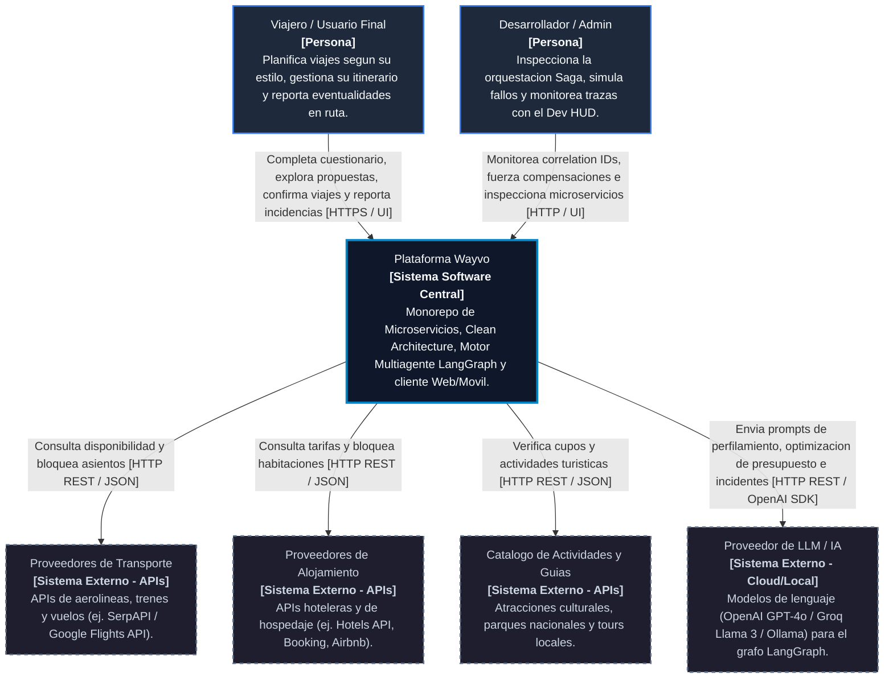

# C4 Model - Nivel 1: Diagrama de Contexto del Sistema

## 1. Vision General del Sistema Wayvo

Wayvo es una plataforma de planificacion, reservas y gestion dinamica de viajes construida sobre una arquitectura desacoplada de microservicios. Su proposito es acompanar al viajero antes, durante y despues del viaje:
1. **Antes del viaje:** Perfila psicologicamente al usuario mediante un sistema multiagente de Inteligencia Artificial (LangGraph) para generar propuestas de itinerario hiperpersonalizadas que balancean presupuesto, transporte, alojamiento y actividades.
2. **Confirmacion:** Gestiona la confirmacion integral de los servicios turisticos mediante una transaccion distribuida resiliente con el patron Saga, garantizando consistencia eventual y compensacion automatica si algun proveedor externo falla.
3. **Durante el viaje:** Actua como un gestor de viaje en tiempo real donde el usuario puede confirmar eventos a medida que ocurren, reportar incidencias (vuelo cancelado, tren perdido, lluvia torrencial) y recibir re-planificaciones inmediatas gestionadas por el patron Mediator.

---

## 2. Diagrama de Contexto (Mermaid C4)

---

## 3. Catalogo de Actores y Sistemas

### 3.1 Actores Principales

| Actor | Rol en el Ecosistema | Interaccion con Wayvo |
| :--- | :--- | :--- |
| **Viajero / Usuario Final** | Consumidor principal de la experiencia turistica. | Interactua con la aplicacion cliente multiplataforma (Web y Movil) para realizar el onboarding psicologico, evaluar propuestas generadas por IA, confirmar reservas y administrar las actividades en tiempo real. |
| **Desarrollador / Administrador** | Operador tecnico y evaluador del sistema. | Utiliza el panel de inspeccion de desarrollo (DevInspector HUD) para validar transacciones distribuidas, revisar la bitacora de compensaciones (`CompensationLog`) y conmutar el simulador de fallos de proveedores para pruebas de resiliencia. |

### 3.2 Sistema Central: Plataforma Wayvo

El sistema central esta delimitado dentro del monorepo e incluye:
- **Cliente Multiplataforma (`apps/client`):** Frontend React con Tailwind CSS adaptado para escritorio y dispositivos moviles.
- **API Gateway (`services/api-gateway`):** Punto unico de contacto que implementa el patron Facade y el middleware centralizado de errores (Requisito 8.18).
- **Booking Service (`services/booking-service`):** Orquestador de la transaccion distribuida con el patron Saga.
- **Provider Service (`services/provider-service`):** Capa de integracion que implementa el patron Adapter para normalizar contratos con proveedores externos.
- **Trip Service (`services/trip-service`):** Gestor central del ciclo de vida del viaje que implementa el patron Mediator para coordinar incidencias y re-planificacion.
- **AI Recommendation Service (`services/ai-recommendation`):** Grafo multiagente en Python (LangGraph) para perfilamiento psicologico, asignacion de presupuesto y alternativas ante imprevistos.

### 3.3 Sistemas Externos (Dependencias de Terceros)

| Sistema Externo | Tipo | Proposito y Protocolo |
| :--- | :--- | :--- |
| **Proveedores de Transporte** | API REST / HTTP | Proporciona tarifas, horarios y disponibilidad de vuelos, trenes y buses. Wayvo se comunica a traves de adaptadores especificos (`TransporteAdapter`) para aislar cambios de esquema externos. |
| **Proveedores de Alojamiento** | API REST / HTTP | Proveedores de inventario hotelero y estancias turisticas. Integrado mediante `AlojamientoAdapter`. |
| **Catalogo de Actividades y Tours** | API REST / JSON | Servicios de reserva para excursiones, museos y experiencias locales. |
| **Proveedor de LLM (OpenAI / Groq)** | API Cloud / SDK | Inferencia para los agentes de LangGraph (`personality_agent`, `budget_agent`, `transport_agent`, `activities_food_agent`, `incident_agent`). |

---

## 4. Flujos de Valor Clave a Nivel de Contexto

### Flujo 1: Planificacion Inteligente Asistida por IA
1. El Viajero completa el test de afinidad psicologica y preferencias (presupuesto, fechas, acompanantes, tipo de viaje).
2. Wayvo invoca a los agentes de IA para sintetizar un perfil de viajero (Aventura, Relax, Cultural, Inversion).
3. El sistema consulta a los proveedores de transporte, alojamiento y actividades, consolidando una propuesta integral con estimacion presupuestaria desglosada.

### Flujo 2: Confirmacion con Garantia de Consistencia (Saga)
1. El Viajero decide confirmar su viaje desde la interfaz.
2. Wayvo coordina internamente la reserva en sus bases de datos y la verificacion con proveedores externos.
3. Si un proveedor externo rechaza la solicitud o se encuentra indisponible, el sistema activa automaticamente un rollback compensatorio, liberando las reservas previas y notificando al viajero sin inconsistencias en sus datos.

### Flujo 3: Adaptabilidad en Ruta (Manejo de Imprevistos con Mediator)
1. Durante el viaje, el Viajero reporta una eventualidad (ej. "Perdi el vuelo de conexion" o "El museo cerro por clima").
2. Wayvo canaliza la novedad a traves del mediador central, consulta al motor de IA para proponer alternativas viables en tiempo y costo, y actualiza el itinerario en vivo al seleccionar una opcion.
