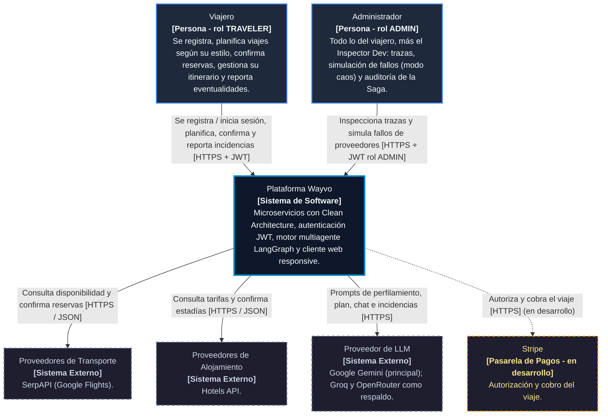

# C4 Model - Nivel 1: Diagrama de Contexto del Sistema

## 1. Visión General del Sistema Wayvo

Wayvo es una plataforma **multiusuario** de planificación, reservas y gestión dinámica de viajes construida sobre una arquitectura de microservicios. Acompaña al viajero antes, durante y después del viaje:

1. **Cuenta propia (multiusuario):** cada viajero se registra e inicia sesión. Sus viajes, reservas e itinerarios son privados: ningún otro usuario puede verlos ni modificarlos.
2. **Antes del viaje:** perfila al viajero con un sistema multiagente de IA (LangGraph + Gemini) que genera propuestas de itinerario personalizadas balanceando presupuesto, transporte, alojamiento y actividades.
3. **Confirmación:** confirma los servicios con una transacción distribuida resiliente (patrón **Saga**), con compensación automática si algún proveedor falla. Las reservas de cupos son atómicas: dos viajeros no pueden quedarse con el mismo último cupo.
4. **Durante el viaje:** el viajero marca el avance de su itinerario, reporta incidencias (vuelo cancelado, tren perdido, lluvia) y recibe alternativas que se integran al itinerario mediante el patrón **Mediator**.
5. **Pago (en desarrollo):** cobro del viaje con la pasarela **Stripe**, integrado como un paso más de la Saga.

---

## 2. Diagrama de Contexto (Mermaid C4)

---

## 3. Catálogo de Actores y Sistemas

### 3.1 Actores

| Actor | Rol | Interacción con Wayvo |
| :--- | :--- | :--- |
| **Viajero** | `TRAVELER` (rol por defecto al registrarse) | Usa la aplicación web para crear su cuenta, completar el perfilamiento, evaluar propuestas de la IA, confirmar el viaje y administrar su itinerario en tiempo real. Solo ve sus propios viajes y reservas. |
| **Administrador** | `ADMIN` (correos definidos en `ADMIN_EMAILS`) | Además de lo anterior, activa el **modo Dev**: Inspector de red, bitácora de compensaciones (`CompensationLog`) y simulador de fallos de proveedores (`/api/v1/mock/*`, bloqueado para viajeros con HTTP 403). |

### 3.2 Sistema central: Plataforma Wayvo

Delimitado dentro del monorepo:
- **Cliente web (`apps/client`):** React + Vite + Tailwind, responsive para escritorio y móvil. Pantalla de login/registro y sesión con JWT.
- **API Gateway (`services/api-gateway`):** punto único de entrada. Valida el JWT, propaga la identidad (`x-user-id`), implementa el patrón **Facade** y el middleware centralizado de errores (Requisito 8.18).
- **Auth Service (`services/auth-service`):** registro, login y emisión de tokens JWT (multiusuario).
- **Booking Service (`services/booking-service`):** reservas y orquestador de la **Saga**.
- **Provider Service (`services/provider-service`):** catálogo de proveedores, reserva atómica de cupos y patrón **Adapter** hacia las APIs externas.
- **Trip Service (`services/trip-service`):** ciclo de vida del viaje e itinerario; patrón **Mediator** para incidencias.
- **AI Recommendation (`services/ai-recommendation`):** grafo multiagente LangGraph (Python) para el plan de viaje, chat e incidencias.

### 3.3 Sistemas externos

| Sistema Externo | Tipo | Propósito |
| :--- | :--- | :--- |
| **SerpAPI (Google Flights)** | API REST | Vuelos: tarifas, horarios y disponibilidad. Integrado con `TransporteAdapter`. |
| **Hotels API** | API REST | Inventario hotelero. Integrado con `AlojamientoAdapter`. |
| **Google Gemini / Groq / OpenRouter** | API de LLM | Inferencia para los agentes de LangGraph. Si un proveedor falla por cuota o red, se conmuta al siguiente. |
| **Stripe** *(en desarrollo)* | Pasarela de pagos | Autorización y cobro del viaje como paso de la Saga, con anulación del cobro como compensación. |

---

## 4. Flujos de Valor a Nivel de Contexto

### Flujo 0: Registro e inicio de sesión (multiusuario)
1. El viajero crea su cuenta (nombre, correo, contraseña) o inicia sesión.
2. Wayvo devuelve un token de sesión (JWT) que el cliente envía en cada petición.
3. Desde ese momento todo lo que crea (viajes, reservas) queda a su nombre y es invisible para otros usuarios.

### Flujo 1: Planificación inteligente asistida por IA
1. El viajero completa el perfilamiento (presupuesto, fechas, acompañantes, intereses).
2. Los agentes de IA sintetizan su estilo de viaje (Aventura, Relax, Cultural, Gastronómico, Eco-Turismo) y arman transporte, alojamiento, actividades y presupuesto.
3. Wayvo devuelve una propuesta de itinerario con el desglose de costos.

### Flujo 2: Confirmación con garantía de consistencia (Saga)
1. El viajero confirma su viaje.
2. Wayvo crea el viaje y la reserva, y aparta los cupos con los proveedores.
3. Si un proveedor rechaza o no hay cupo, se ejecuta un rollback compensatorio automático y el viajero recibe un mensaje claro, sin registros huérfanos.

### Flujo 3: Adaptabilidad en ruta (Mediator)
1. Durante el viaje, el viajero reporta una eventualidad (ej. "Perdí el vuelo").
2. Wayvo registra la incidencia, propone alternativas y, al elegir una, reemplaza el evento afectado en el itinerario.
