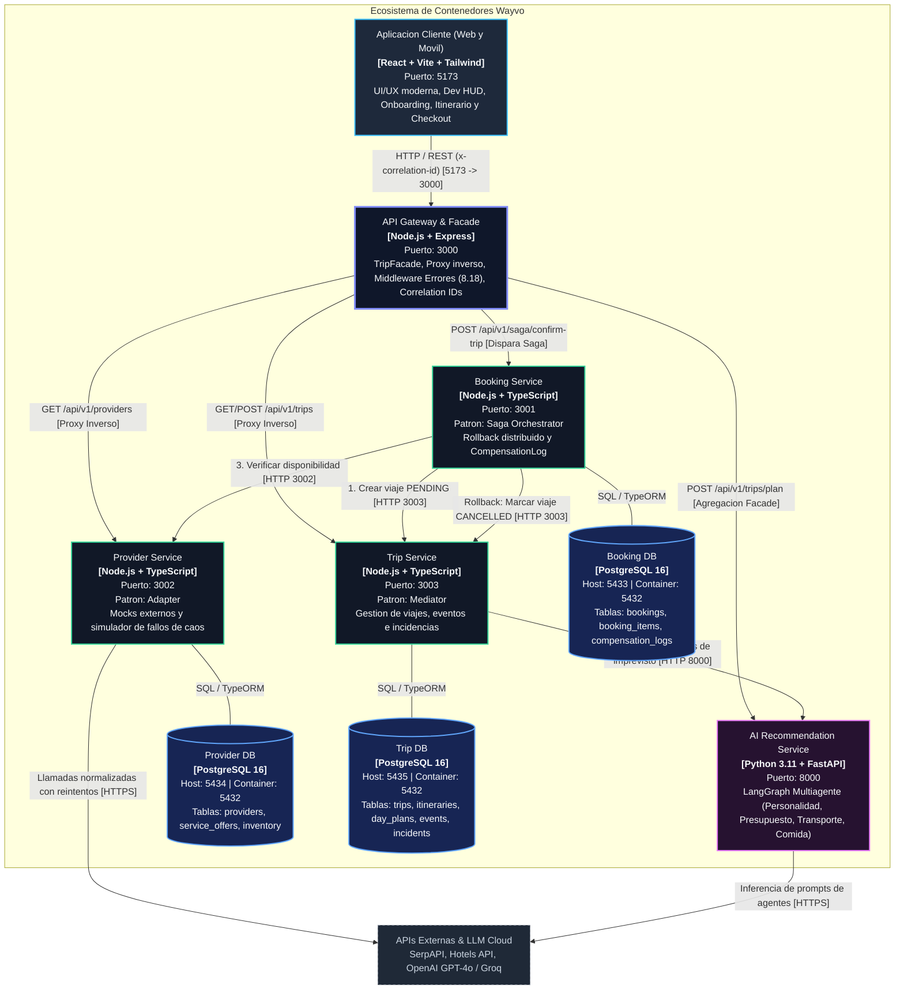

# C4 Model - Nivel 2: Diagrama de Contenedores

## 1. Vision General de Contenedores

El nivel 2 del modelo C4 describe la arquitectura de ejecucion y despliegue del sistema **Wayvo**. La plataforma se organiza como un **Monorepo de Microservicios** donde cada contenedor representa una aplicacion ejecutable o almacen de datos independiente con responsabilidades bien delimitadas:

- **1 Contenedor Cliente:** Aplicacion Single Page Application (SPA) responsive en React + TypeScript servida por Vite.
- **1 Contenedor API Gateway:** Punto unico de entrada HTTP con Express, proxy inverso y agregacion mediante el patron Facade.
- **3 Microservicios Core en Node.js/TypeScript:** `booking-service` (Saga), `provider-service` (Adapter) y `trip-service` (Mediator).
- **1 Microservicio de Inteligencia Artificial en Python:** `ai-recommendation` con FastAPI y el motor de grafos multiagente LangGraph.
- **3 Bases de Datos Relacionales PostgreSQL:** Implementando el patron arquitectonico Database-per-Service para garantizar autonomia y aislamiento de fallos.

---

## 2. Diagrama de Contenedores (Mermaid C4)

---

## 3. Catalogo Detallado de Contenedores

| Contenedor | Tecnologia | Puerto Host / Interno | Patron Asignado | Responsabilidad Principal |
| :--- | :--- | :--- | :--- | :--- |
| **`client`** | React 18, Vite, Tailwind CSS, TypeScript | `5173:80` (o dev) | Componentes UI / Presentacion | Interfaz multiplataforma (Web y Movil responsive). Incluye Onboarding psicologico, visualizador de propuestas, gestor interactivo de viaje en tiempo real, modal de incidencias y el DevInspector HUD para auditoria en vivo. |
| **`api-gateway`** | Node.js, Express, TypeScript | `3000:3000` | **Facade** | Punto unico de entrada. Expone `/api/v1/trips/plan` y `/api/v1/trips/checkout` orquestando servicios internos. Implementa proxy dinamico para microservicios y el middleware centralizado de errores (Requisito 8.18). Inyecta y propaga el encabezado `x-correlation-id`. |
| **`booking-service`** | Node.js, TypeScript, TypeORM | `3001:3001` | **Saga (Orquestador)** | Coordina transacciones distribuidas para confirmar viajes. Ejecuta la secuencia hacia adelante (crear viaje -> crear reserva -> verificar proveedor) y el rollback compensatorio automatico si ocurre una falla externa, registrando la auditoria en `CompensationLog`. |
| **`booking_db`** | PostgreSQL 16 Alpine | `5433:5432` | Database-per-Service | Persistencia exclusiva de reservas, items reservados y bitacora de compensaciones. |
| **`provider-service`** | Node.js, TypeScript, TypeORM | `3002:3002` | **Adapter** | Normaliza la comunicacion con APIs externas heterogeneas (vuelos, hoteles, actividades) mediante la interfaz target `IProveedorExterno`. Incluye un simulador con interruptor de caos (`/simulate-failure?mode=unavailable`) para pruebas de resiliencia. |
| **`provider_db`** | PostgreSQL 16 Alpine | `5434:5432` | Database-per-Service | Persistencia de proveedores registrados, ofertas de servicio y catalogo de inventario precargado. |
| **`trip-service`** | Node.js, TypeScript, TypeORM | `3003:3003` | **Mediator** | Mantiene el ciclo de vida del viaje (`DRAFT`, `CONFIRMED`, `CANCELLED`). Contiene el mediador `TripMediator` que desacopla `EventService`, `AlternativeService` y `TripService` al reportar incidencias e inyectar eventos sustitutos. |
| **`trip_db`** | PostgreSQL 16 Alpine | `5435:5432` | Database-per-Service | Persistencia de viajes, itinerarios por dias, eventos de viaje, incidentes registrados y alternativas generadas. |
| **`ai-recommendation`** | Python 3.11, FastAPI, LangGraph | `8000:8000` | Multiagente Inteligente | Grafo de estados (`StateGraph`) que orquesta agentes especializados (`personality_agent`, `budget_agent`, `transport_agent`, `activities_food_agent`, `hotel_agent`, `incident_agent`). Entrega contratos JSON estandarizados consumibles por el frontend y `TripService`. |

---

## 4. Decisiones Arquitectonicas del Nivel Contenedor

### 4.1 Patron Database-per-Service
Cada microservicio es propietario exclusivo de su base de datos relacional. Ningun microservicio tiene acceso directo ni realiza consultas cruzadas sobre las tablas de otro microservicio. Toda comunicacion de datos entre dominios se realiza estrictamente a traves de APIs REST bien definidas, evitando el antipatron de base de datos compartida y garantizando que los despliegues y migraciones sean completamente independientes.

### 4.2 Desacoplamiento del Cliente via Facade en el API Gateway
El cliente web/movil no conoce las URLs ni los puertos de los microservicios individuales (3001, 3002, 3003, 8000). Solo interactua con el puerto 3000. 
- **Beneficio 1:** Se reduce drasticamente el numero de conexiones y round-trips de red (`chatty I/O`) para dispositivos moviles.
- **Beneficio 2:** Se aisla al cliente de refactorizaciones o reubicaciones internas de microservicios.
- **Beneficio 3:** Se centraliza el formato de respuesta de error mediante un unico middleware (Requisito 8.18).

### 4.3 Trazabilidad Distribuida con Correlation ID
Cada solicitud que ingresa al Gateway recibe un encabezado HTTP `x-correlation-id` (generado si no viene provisto). Este identificador viaja en cada salto entre microservicios (Gateway -> Booking -> Trip -> Provider -> AI) y se imprime en los logs de consola y en la base de datos `CompensationLog`, permitiendo reconstruir la traza exacta de cualquier transaccion distribuida en milisegundos.
