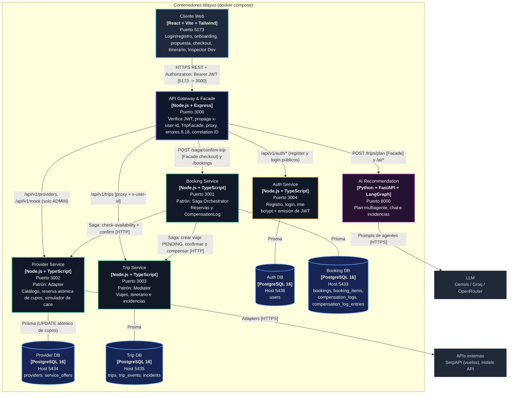

# C4 Model - Nivel 2: Diagrama de Contenedores

## 1. Visión General de Contenedores

El nivel 2 describe las aplicaciones ejecutables y los almacenes de datos de **Wayvo**. Todo se levanta con `docker compose up --build`:

- **1 cliente web:** SPA responsive en React + TypeScript servida por Vite.
- **1 API Gateway:** punto único de entrada (Express). Autenticación JWT, proxy inverso y patrón **Facade**.
- **4 microservicios en Node.js/TypeScript:** `auth-service` (usuarios y JWT), `booking-service` (**Saga**), `provider-service` (**Adapter**) y `trip-service` (**Mediator**).
- **1 microservicio de IA en Python:** `ai-recommendation` (FastAPI + LangGraph).
- **4 bases de datos PostgreSQL 16:** una por servicio (**Database-per-Service**), con Prisma como ORM y migraciones.

---

## 2. Diagrama de Contenedores (Mermaid C4)

> **Stripe (en desarrollo):** se agregará un `payment-service` con su propia base de datos, invocado por la Saga como paso `CAPTURE_PAYMENT`, con anulación del cobro como compensación.

---

## 3. Catálogo de Contenedores

| Contenedor | Tecnología | Puerto host:contenedor | Patrón / rol | Responsabilidad |
| :--- | :--- | :--- | :--- | :--- |
| **`client`** | React 18, Vite, Tailwind, TypeScript | `5173:5173` | Presentación | Login/registro, onboarding psicológico, propuesta de la IA, checkout, itinerario en vivo, incidencias e Inspector Dev (solo ADMIN). Guarda el JWT y lo envía en cada petición. |
| **`api-gateway`** | Node.js, Express | `3000:3000` | **Facade** + autenticación | Punto único de entrada. Verifica el JWT, descarta headers de identidad falsificados y propaga `x-user-id`/`x-user-role`. Expone `/trips/plan` y `/trips/checkout` (Facade), proxy al resto y middleware de errores (8.18). |
| **`auth-service`** | Node.js, Express 5, bcryptjs, jsonwebtoken | `3004:3004` | Multiusuario | Registro, login y `/me`. Guarda contraseñas solo como hash bcrypt y firma los JWT (HS256) con `JWT_SECRET`. |
| **`auth-db`** | PostgreSQL 16 | `5436:5432` | Database-per-Service | Tabla `users` (correo único). |
| **`booking-service`** | Node.js, Express 5, Prisma | `3001:3001` | **Saga (orquestador)** | Reservas y coordinación de la confirmación: crear viaje → crear reserva → reservar con proveedores → confirmar, o compensar en orden inverso registrando `CompensationLog`. |
| **`booking-db`** | PostgreSQL 16 | `5433:5432` | Database-per-Service | Reservas, ítems y bitácora de compensaciones. |
| **`provider-service`** | Node.js, Express, Prisma | `3002:3002` | **Adapter** | Normaliza APIs externas heterogéneas con `IProveedorExterno`. Aparta cupos con un `UPDATE` atómico (concurrencia multiusuario). Simulador de fallos para demos. |
| **`provider-db`** | PostgreSQL 16 | `5434:5432` | Database-per-Service | Proveedores y ofertas (catálogo precargado). |
| **`trip-service`** | Node.js, Express, Prisma | `3003:3003` | **Mediator** | Ciclo de vida del viaje (`PENDING`, `CONFIRMED`, `ACTIVE`, `CANCELLED`), itinerario y eventos. `TripMediator` coordina `EventService`, `AlternativeService` y `TripService` ante incidencias. Verifica que cada viaje sea del usuario. |
| **`trip-db`** | PostgreSQL 16 | `5435:5432` | Database-per-Service | Viajes, eventos del itinerario e incidentes. |
| **`ai-recommendation`** | Python, FastAPI, LangGraph | `8000:8000` | Multiagente | Grafo `StateGraph` con `personality_agent`, `transport_agent`, `activities_food_agent`, `provider_catalog`, `budget_agent` e `itinerary_builder`. También chat libre e `incident_agent`. |

---

## 4. Decisiones Arquitectónicas del Nivel Contenedor

### 4.1 Database-per-Service
Cada microservicio es dueño exclusivo de su base de datos. Ningún servicio consulta tablas de otro: los datos entre dominios viajan solo por APIs REST. Así los despliegues y migraciones son independientes. Por ejemplo, `booking-service` guarda el `userId` de la reserva, pero los usuarios viven solo en `auth-db`.

### 4.2 Autenticación centralizada en el API Gateway (multiusuario)
- `auth-service` **emite** el JWT; el gateway lo **verifica** localmente con el mismo `JWT_SECRET`, sin llamar a `auth-service` en cada petición (autenticación *stateless*).
- Solo `/health`, `/api/v1/auth/register` y `/api/v1/auth/login` son públicas; el resto responde **401** sin token válido.
- El gateway **borra** cualquier `x-user-id` enviado por el cliente y escribe el verdadero. Los servicios internos confían en ese header porque solo el gateway lo escribe.
- **Autorización por dueño:** `trip-service` y `booking-service` responden **404** si el recurso pertenece a otro usuario (no se revela que existe).
- **Autorización por rol:** `/api/v1/mock/*` (modo caos) exige rol `ADMIN` (**403** para viajeros).
- **Límite de confianza:** las llamadas internas de la Saga no pasan por el gateway. En un despliegue real, solo el gateway se expone a internet.

### 4.3 Desacoplamiento del cliente con Facade
El cliente solo conoce el puerto 3000. `TripFacade` agrega en una sola llamada la planificación con IA (`/trips/plan`) y la confirmación con Saga (`/trips/checkout`), reduciendo round-trips y aislando al cliente de cambios internos.

### 4.4 Concurrencia en la reserva de cupos
Con varios usuarios, "leer cupo → restar → guardar" provoca *lost updates* (se vende dos veces el último cupo). `provider-service` aparta cupos con un `UPDATE ... WHERE available_capacity >= n` atómico. Quien pierde la carrera recibe un rechazo y la Saga compensa.

### 4.5 Trazabilidad con Correlation ID
Cada petición recibe un `x-correlation-id` que viaja por todos los saltos (Gateway → Booking → Trip → Provider) y aparece en los logs y en `CompensationLog`, permitiendo reconstruir cualquier transacción distribuida.
