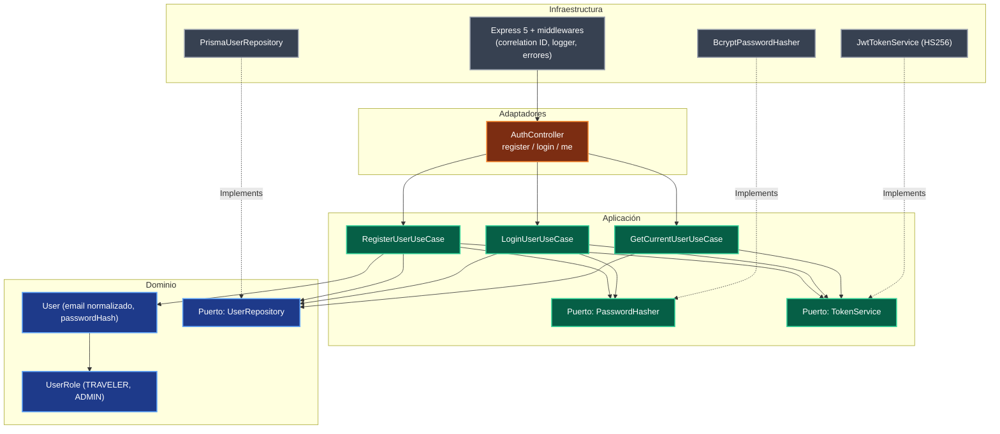
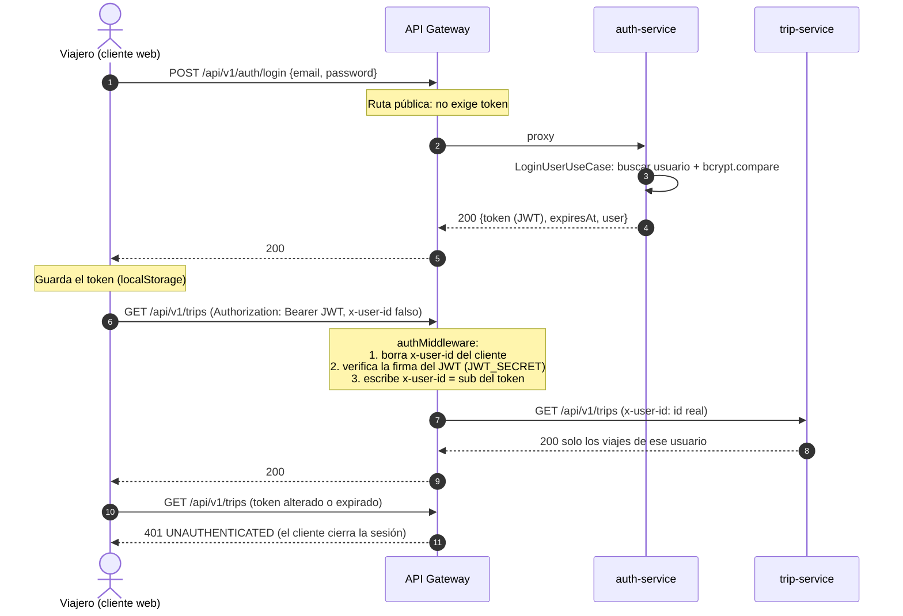
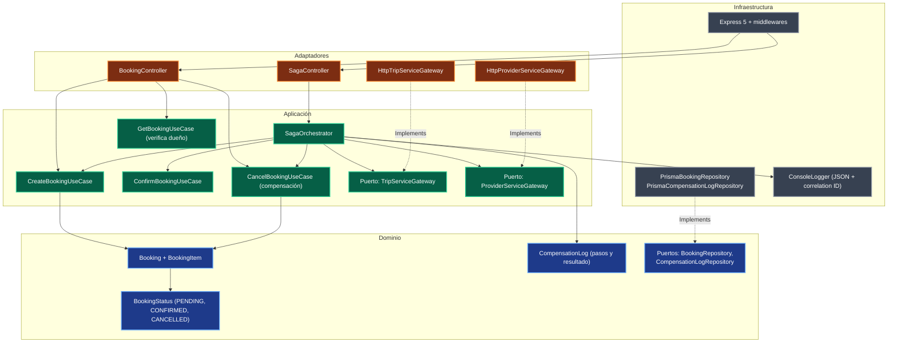
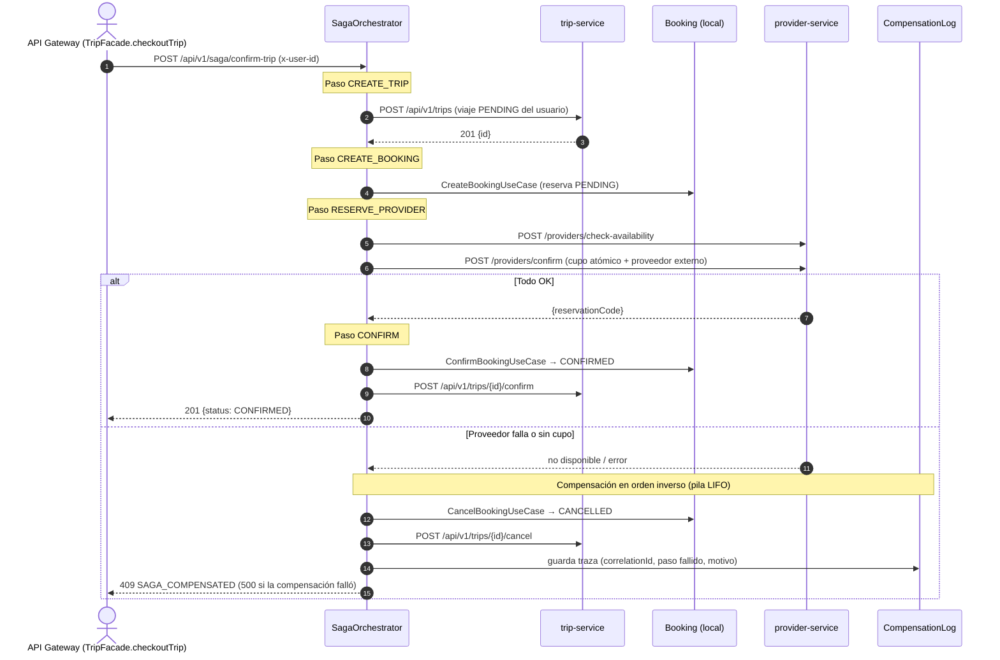
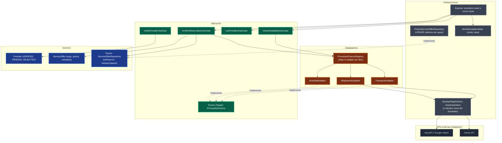
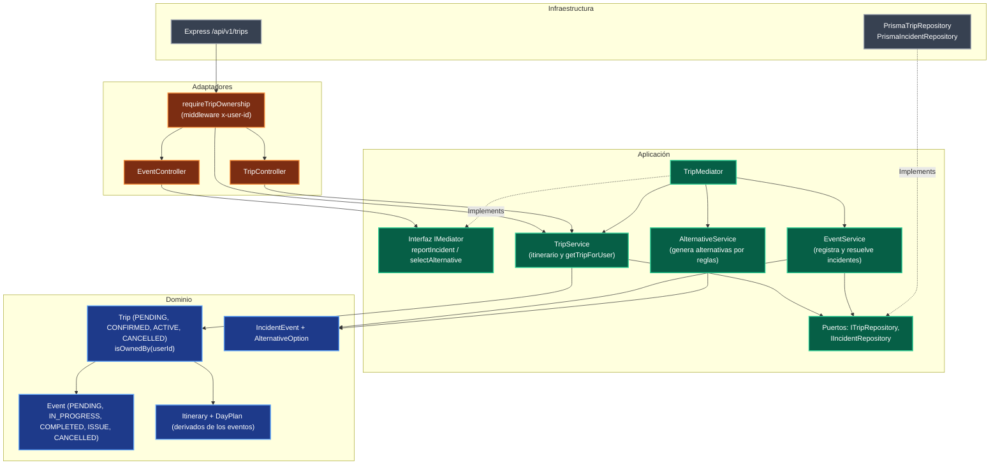
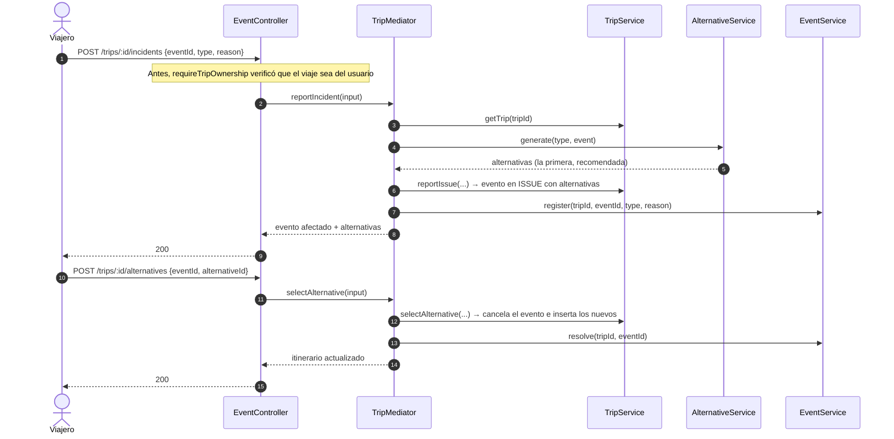

# C4 Model - Nivel 3: Componentes y Clean Architecture

## 1. Clean Architecture en Wayvo

Los microservicios en Node.js (`auth-service`, `booking-service`, `provider-service`, `trip-service`) y el `api-gateway` siguen **Clean Architecture** con cuatro capas:

```text
       ┌─────────────────────────────────────────────────────────┐
       │                   INFRASTRUCTURE                        │
       │  (Prisma, Express, bcrypt, JWT, clientes HTTP, logger)  │
       │   ┌─────────────────────────────────────────────────┐   │
       │   │                    ADAPTERS                     │   │
       │   │  (Controllers, rutas, middlewares, gateways)    │   │
       │   │   ┌─────────────────────────────────────────┐   │   │
       │   │   │               APPLICATION               │   │   │
       │   │   │ (Casos de uso, puertos, Saga, Mediator) │   │   │
       │   │   │   ┌─────────────────────────────────┐   │   │   │
       │   │   │   │             DOMAIN              │   │   │   │
       │   │   │   │ (Entidades, value objects, enums)│  │   │   │
       │   │   │   └─────────────────────────────────┘   │   │   │
       │   │   └─────────────────────────────────────────┘   │   │
       │   └─────────────────────────────────────────────────┘   │
       └─────────────────────────────────────────────────────────┘
```

**Regla de dependencia:** el código apunta siempre hacia adentro. El dominio no conoce a nadie; la aplicación habla con el exterior solo mediante **puertos** (interfaces); las implementaciones concretas (Prisma, HTTP, bcrypt, JWT) se eligen únicamente en el `container.ts` de cada servicio (raíz de composición).

---

## 2. `auth-service` (multiusuario)

### 2.1 Componentes



### 2.2 Secuencia: login y petición autenticada



---

## 3. `booking-service` (patrón Saga - orquestador)

### 3.1 Componentes



### 3.2 Secuencia de la Saga



---

## 4. `provider-service` (patrón Adapter)

### 4.1 Componentes



### 4.2 Por qué Adapter
SerpAPI y Hotels API tienen firmas, parámetros y respuestas distintas. `IProveedorExterno` define una interfaz única (`consultarDisponibilidad`, `confirmarReserva`) y cada adapter traduce el modelo de Wayvo al formato del proveedor. Cambiar de proveedor implica solo un adapter nuevo: los casos de uso no cambian.

### 4.3 Reserva atómica de cupos (concurrencia multiusuario)
`ConfirmReservationUseCase` primero **aparta el cupo** con `tryReserve` (un `UPDATE ... WHERE available_capacity >= n` que PostgreSQL ejecuta de forma atómica), luego confirma con el proveedor externo y, si este falla, **devuelve el cupo** con `releaseCapacity`. `save()` nunca sobrescribe el cupo, para que un guardado con datos viejos no pise una reserva concurrente.

---

## 5. `trip-service` (patrón Mediator)

### 5.1 Componentes



`EventService`, `AlternativeService` y `TripService` **no se conocen entre sí**: solo el `TripMediator` los coordina (hay un test que verifica ese desacoplamiento).

### 5.2 Secuencia: incidencia en ruta



> Además, el cliente puede pedir alternativas contextuales a la IA (`POST /api/v1/ai/incidents/resolve`, agente `incident_agent`) y aplicarlas con `POST /trips/:id/resolve-incident`.

---

## 6. Tabla Maestra de Mapeo Arquitectónico

| Patrón / mecanismo | Capa | Archivos clave | Responsabilidad |
| :--- | :--- | :--- | :--- |
| **Saga (orquestador)** | `application/saga` | [`saga-orchestrator.ts`](../../services/booking-service/src/application/saga/saga-orchestrator.ts) | Pasos hacia adelante, compensación en orden inverso y `CompensationLog`. |
| **Facade** | `application/facades` | [`trip.facade.ts`](../../services/api-gateway/src/application/facades/trip.facade.ts) | Unifica IA (plan) y Saga (checkout) en endpoints simples para el cliente. |
| **Adapter** | `adapters/external` | [`proveedor-externo.port.ts`](../../services/provider-service/src/application/ports/proveedor-externo.port.ts), [`transporte.adapter.ts`](../../services/provider-service/src/adapters/external/transporte.adapter.ts), [`alojamiento.adapter.ts`](../../services/provider-service/src/adapters/external/alojamiento.adapter.ts) | Traducen SerpAPI y Hotels API al puerto `IProveedorExterno`. |
| **Mediator** | `application/mediator` | [`IMediator.ts`](../../services/trip-service/src/application/mediator/IMediator.ts), [`TripMediator.ts`](../../services/trip-service/src/application/mediator/TripMediator.ts) | Coordina `EventService`, `AlternativeService` y `TripService` sin dependencias cruzadas. |
| **Autenticación JWT** | gateway `adapters/http/middlewares` + `auth-service` | [`auth.middleware.ts`](../../services/api-gateway/src/adapters/http/middlewares/auth.middleware.ts), [`jwt-token.service.ts`](../../services/auth-service/src/infrastructure/token/jwt-token.service.ts), [`register-user.use-case.ts`](../../services/auth-service/src/application/use-cases/register-user.use-case.ts) | Emisión y verificación de tokens, propagación de identidad, roles. |
| **Aislamiento por usuario** | trip / booking | [`identity.ts`](../../services/trip-service/src/adapters/middlewares/identity.ts), [`get-booking.use-case.ts`](../../services/booking-service/src/application/use-cases/get-booking.use-case.ts) | Cada usuario solo ve y modifica lo suyo (404 si es ajeno). |
| **Reserva atómica** | provider `infrastructure/persistence` | [`prisma-service-offer.repository.ts`](../../services/provider-service/src/infrastructure/persistence/prisma/prisma-service-offer.repository.ts), [`confirm-reservation.use-case.ts`](../../services/provider-service/src/application/use-cases/confirm-reservation.use-case.ts) | Evita vender dos veces el mismo cupo con usuarios concurrentes. |
