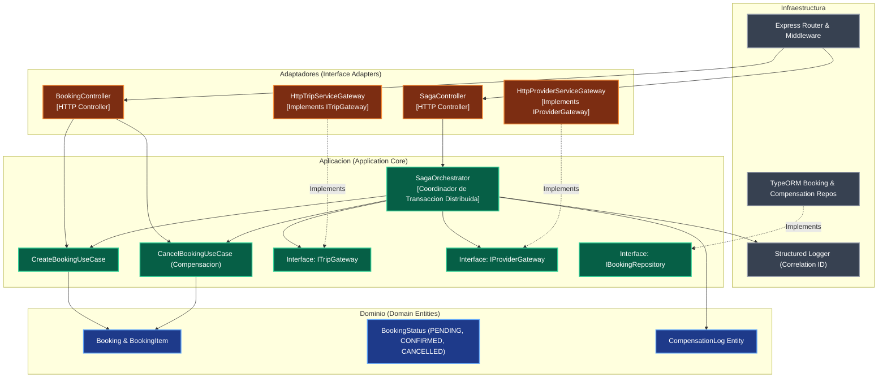
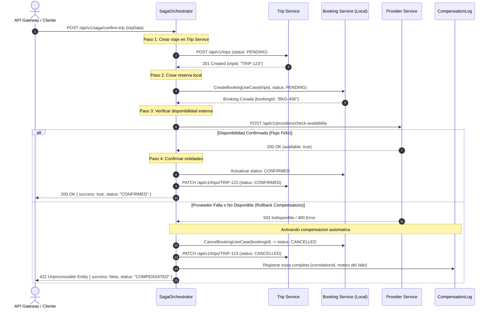
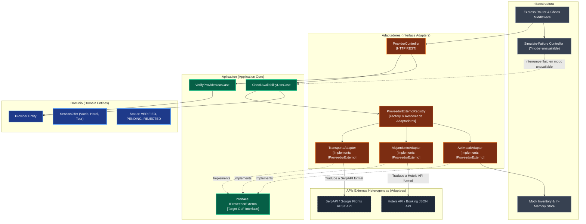
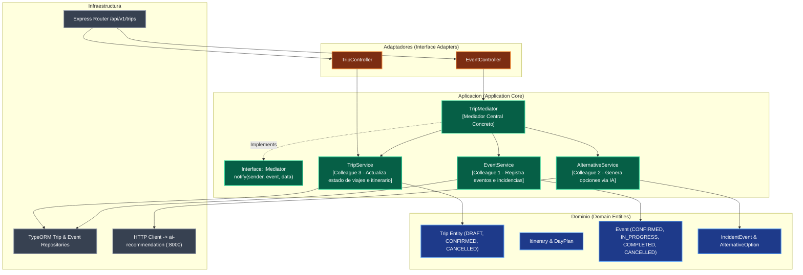
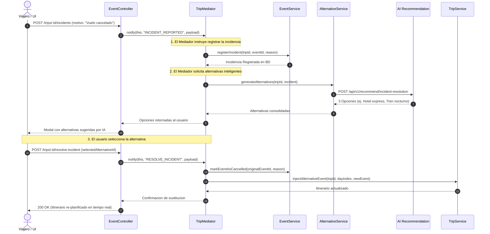

# C4 Model - Nivel 3: Diagrama de Componentes y Clean Architecture

## 1. Vision General de Clean Architecture en Wayvo

Cada microservicio en Wayvo (`booking-service`, `provider-service`, `trip-service`) esta estructurado siguiendo los principios estrictos de **Clean Architecture** (Arquitectura Limpia) y el principio de inversion de dependencias:

```text
       ┌─────────────────────────────────────────────────────────┐
       │                   INFRASTRUCTURE                        │
       │     (TypeORM, Express Server, Logging, HTTP Clients)    │
       │   ┌─────────────────────────────────────────────────┐   │
       │   │                    ADAPTERS                     │   │
       │   │    (Controllers, Routes, Gateways, Adapters)    │   │
       │   │   ┌─────────────────────────────────────────┐   │   │
       │   │   │               APPLICATION               │   │   │
       │   │   │ (Use Cases, Ports, Orchestrators/Mediators)│   │
       │   │   │   ┌─────────────────────────────────┐   │   │   │
       │   │   │   │             DOMAIN              │   │   │   │
       │   │   │   │ (Entities, Value Objects, Enums)│   │   │   │
       │   │   │   └─────────────────────────────────┘   │   │   │
       │   │   └─────────────────────────────────────────┘   │   │
       │   └─────────────────────────────────────────────────┘   │
       └─────────────────────────────────────────────────────────┘
```

**Regla de Dependencia:** Las dependencias del codigo apuntan estrictamente hacia adentro. La capa de Dominio no conoce a la de Aplicacion, la de Aplicacion no conoce detalles de infraestructura (bases de datos ni frameworks web), y los adaptadores interactuan con la aplicacion unicamente mediante **Puertos (Interfaces)**.

---

## 2. Componentes de `booking-service` (Patron Saga - Orquestador)

### 2.1 Diagrama de Componentes C4



### 2.2 Secuencia de la Transaccion Distribuida Saga



---

## 3. Componentes de `provider-service` (Patron Adapter)

### 3.1 Diagrama de Componentes C4



### 3.2 Justificacion del Patron Adapter
Las APIs de aerolineas (`SerpAPI / Google Flights`) y hoteles (`Hotels API`) poseen firmas, nombres de campos, parametros y formatos de respuesta dispares. El patron **Adapter**:
1. Define la interfaz uniforme `IProveedorExterno` en la capa de aplicacion con los metodos:
   - `consultarDisponibilidad(criterios: DisponibilidadQuery): Promise<DisponibilidadResultado>`
   - `confirmarReserva(datos: ReservaDatos): Promise<ConfirmacionResultado>`
2. Los adaptadores concretos (`TransporteAdapter`, `AlojamientoAdapter`) traducen los objetos del dominio Wayvo hacia el payload especifico de cada proveedor externo.
3. Si un proveedor externo cambia su esquema JSON o se reemplaza por otro, el codigo de negocio y los casos de uso no sufren modificaciones; unicamente se actualiza el adaptador correspondiente.

---

## 4. Componentes de `trip-service` (Patron Mediator)

### 4.1 Diagrama de Componentes C4



### 4.2 Interaccion del Mediador ante una Incidencia en Ruta



---

## 5. Tabla Maestra de Mapeo Arquitectonico

| Patron | Capa Clean Architecture | Archivos Clave en el Repositorio | Responsabilidad del Componente |
| :--- | :--- | :--- | :--- |
| **Saga (Orquestador)** | `application/saga` | [`saga-orchestrator.ts`](file:///Users/alexy/Documents/Uninorte/Octavo%20Semestre/Disen%CC%83o%202/Wayvo/services/booking-service/src/application/saga/saga-orchestrator.ts) | Coordina el ciclo de vida de la transaccion distribuida, bifurcaciones de rollback y registro de `CompensationLog`. |
| **Facade** | `application/facades` | [`trip.facade.ts`](file:///Users/alexy/Documents/Uninorte/Octavo%20Semestre/Disen%CC%83o%202/Wayvo/services/api-gateway/src/application/facades/trip.facade.ts) | Unifica llamadas a IA y Booking; expone interfaces simplificadas al cliente frontend. |
| **Adapter** | `adapters/external` | [`transporte.adapter.ts`](file:///Users/alexy/Documents/Uninorte/Octavo%20Semestre/Disen%CC%83o%202/Wayvo/services/provider-service/src/adapters/external/transporte.adapter.ts)<br/>[`alojamiento.adapter.ts`](file:///Users/alexy/Documents/Uninorte/Octavo%20Semestre/Disen%CC%83o%202/Wayvo/services/provider-service/src/adapters/external/alojamiento.adapter.ts) | Traducen esquemas de proveedores de vuelos y hoteles al puerto target `IProveedorExterno`. |
| **Mediator** | `application/mediator` | [`TripMediator.ts`](file:///Users/alexy/Documents/Uninorte/Octavo%20Semestre/Disen%CC%83o%202/Wayvo/services/trip-service/src/application/mediator/TripMediator.ts)<br/>[`IMediator.ts`](file:///Users/alexy/Documents/Uninorte/Octavo%20Semestre/Disen%CC%83o%202/Wayvo/services/trip-service/src/application/mediator/IMediator.ts) | Centraliza las notificaciones entre `EventService`, `AlternativeService` y `TripService` evitando dependencias cruzadas. |
