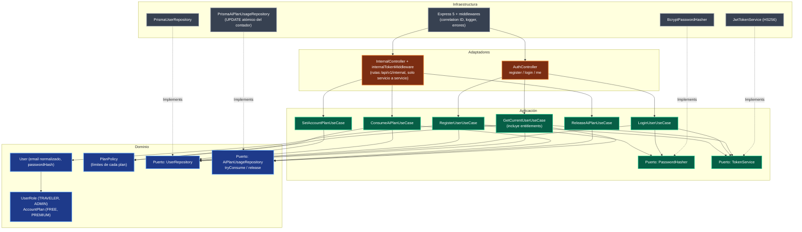
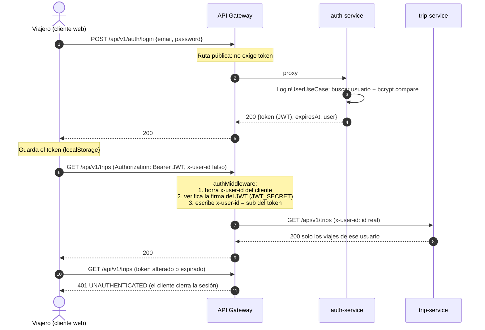
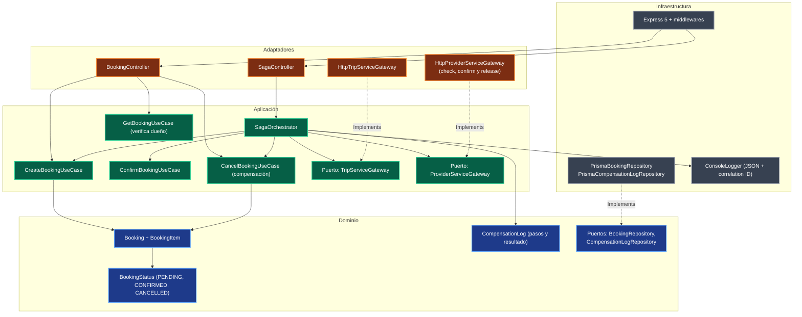
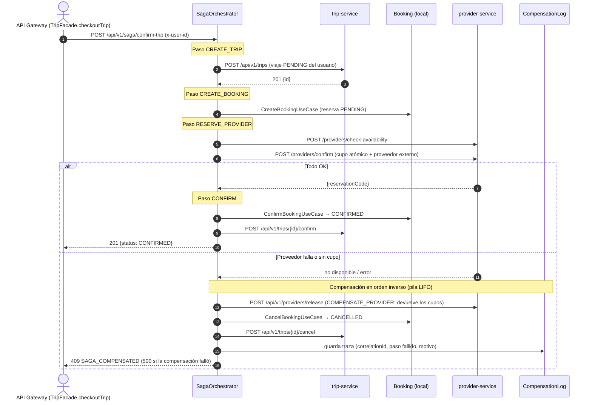
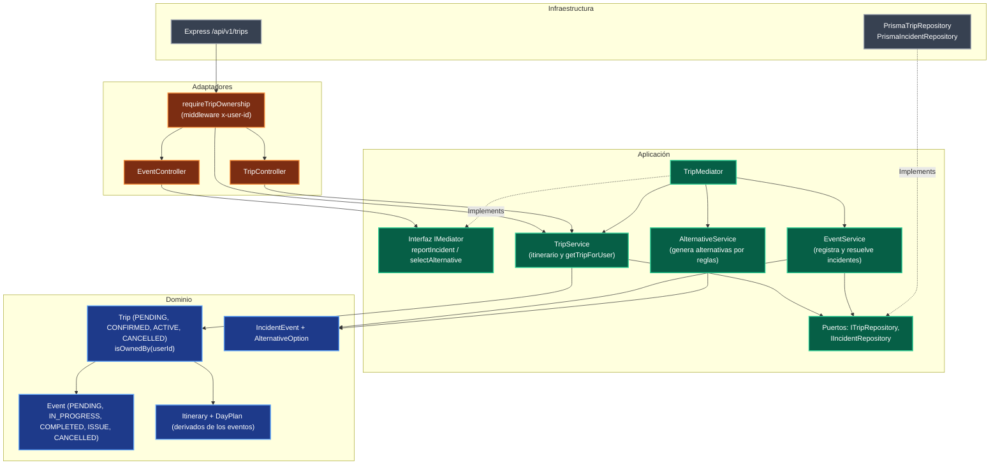
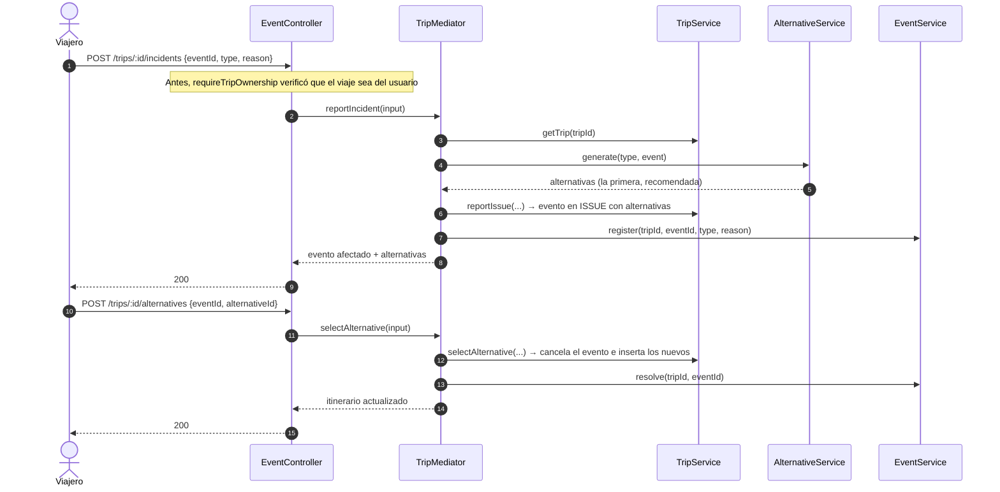
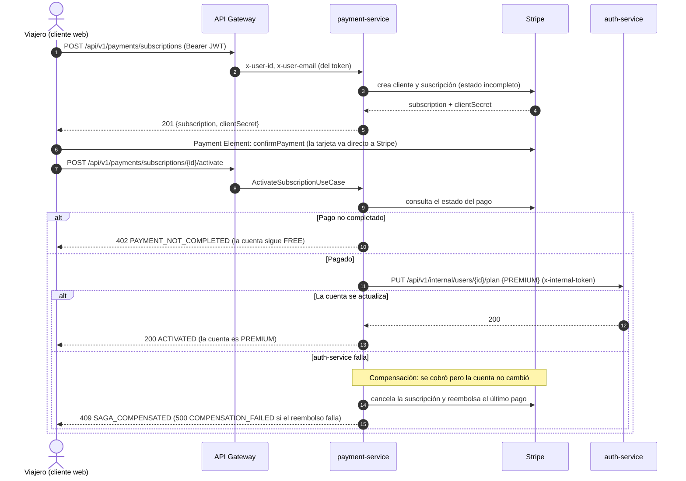
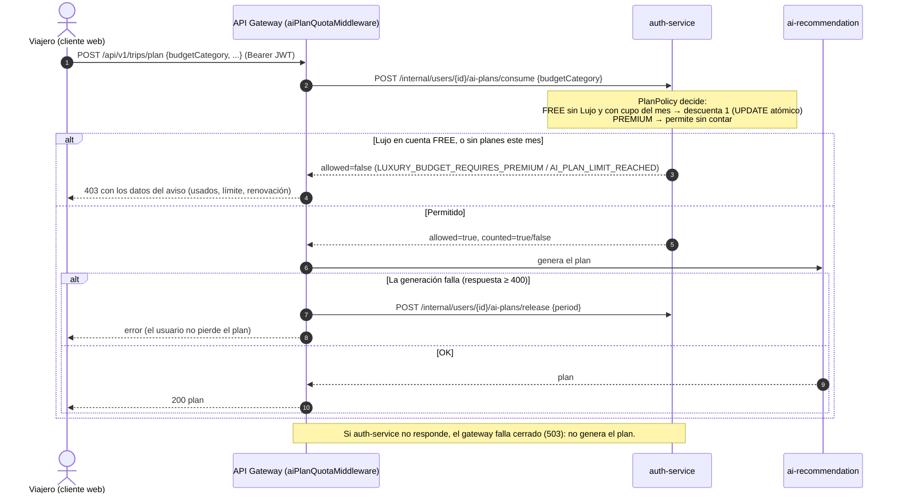

# C4 Model - Nivel 3: Componentes y Clean Architecture

## 1. Clean Architecture en Wayvo

Los microservicios en Node.js (`auth-service`, `booking-service`, `provider-service`, `payment-service`, `trip-service`) y el `api-gateway` siguen **Clean Architecture** con cuatro capas:

```text
       ┌─────────────────────────────────────────────────────────┐
       │                   INFRASTRUCTURE                        │
       │  (Prisma, Express, bcrypt, JWT, clientes HTTP, logger)  │
       │   ┌─────────────────────────────────────────────────┐   │
       │   │                    ADAPTERS                     │   │
       │   │  (Controllers, rutas, middlewares, gateways)    │   │
       │   │   ┌─────────────────────────────────────────┐   │   │
       │   │   │               APPLICATION               │   │   │
       │   │   │ (Casos de uso, puertos, Saga, Mediator) │   │   │
       │   │   │   ┌─────────────────────────────────┐   │   │   │
       │   │   │   │             DOMAIN              │   │   │   │
       │   │   │   │ (Entidades, value objects, enums)│  │   │   │
       │   │   │   └─────────────────────────────────┘   │   │   │
       │   │   └─────────────────────────────────────────┘   │   │
       │   └─────────────────────────────────────────────────┘   │
       └─────────────────────────────────────────────────────────┘
```

**Regla de dependencia:** el código apunta siempre hacia adentro. El dominio no conoce a nadie; la aplicación habla con el exterior solo mediante **puertos** (interfaces); las implementaciones concretas (Prisma, HTTP, bcrypt, JWT) se eligen únicamente en el `container.ts` de cada servicio (raíz de composición).

---

## 2. `auth-service` (multiusuario)

### 2.1 Componentes



### 2.2 Secuencia: login y petición autenticada



---

## 3. `booking-service` (patrón Saga - orquestador)

### 3.1 Componentes



### 3.2 Secuencia de la Saga



---

## 4. `provider-service` (patrón Adapter)

### 4.1 Componentes

```mermaid
flowchart TD
    classDef domain fill:#1e3a8a,stroke:#60a5fa,stroke-width:2px,color:#ffffff;
    classDef app fill:#065f46,stroke:#34d399,stroke-width:2px,color:#ffffff;
    classDef adapter fill:#7c2d12,stroke:#fb923c,stroke-width:2px,color:#ffffff;
    classDef infra fill:#374151,stroke:#9ca3af,stroke-width:2px,color:#ffffff;
    classDef ext fill:#1f2937,stroke:#9ca3af,stroke-width:1px,stroke-dasharray: 4 4,color:#cbd5e1;

    subgraph InfraLayer["Infraestructura"]
        Routers["Express: providers.router y mock.router"]:::infra
        Clients["SerpApiFlightsClient, HotelsApiClient<br/>(o clientes mock del simulador)"]:::infra
        PrismaOffers["PrismaServiceOfferRepository<br/>(UPDATE atómico de cupos)"]:::infra
        Chaos["MockSimulationState (modo caos)"]:::infra
    end

    subgraph AdapterLayer["Adaptadores"]
        Registry["ProveedorExternoRegistry<br/>(elige el adapter por tipo)"]:::adapter
        TransporteAdapter["TransporteAdapter"]:::adapter
        AlojamientoAdapter["AlojamientoAdapter"]:::adapter
        ActividadAdapter["ActividadAdapter"]:::adapter
    end

    subgraph AppLayer["Aplicación"]
        CheckAvailUC["CheckAvailabilityUseCase"]:::app
        ConfirmUC["ConfirmReservationUseCase"]:::app
        ReleaseUC["ReleaseReservationUseCase<br/>(compensación de la Saga)"]:::app
        ListUC["ListProvidersUseCase"]:::app
        VerifyUC["VerifyProviderUseCase"]:::app
        IProvPort["Puerto (Target): IProveedorExterno"]:::app
    end

    subgraph DomainLayer["Dominio"]
        ProviderEntity["Provider (VERIFIED, PENDING, REJECTED)"]:::domain
        OfferEntity["ServiceOffer (cupo, precio, metadata)"]:::domain
        OfferRepoPort["Puerto: ServiceOfferRepository<br/>tryReserve / releaseCapacity"]:::domain
    end

    subgraph Ext["APIs externas (Adaptees)"]
        FlightAPI["SerpAPI / Google Flights"]:::ext
        HotelsAPI["Hotels API"]:::ext
    end

    Routers --> CheckAvailUC
    Routers --> ConfirmUC
    Routers --> ReleaseUC
    ReleaseUC --> OfferRepoPort
    Routers --> ListUC
    Routers --> Chaos

    CheckAvailUC --> Registry
    ConfirmUC --> Registry
    ConfirmUC --> OfferRepoPort
    Registry --> TransporteAdapter
    Registry --> AlojamientoAdapter
    Registry --> ActividadAdapter

    TransporteAdapter -.->|Implements| IProvPort
    AlojamientoAdapter -.->|Implements| IProvPort
    ActividadAdapter -.->|Implements| IProvPort
    PrismaOffers -.->|Implements| OfferRepoPort

    TransporteAdapter --> Clients
    AlojamientoAdapter --> Clients
    Clients --> FlightAPI
    Clients --> HotelsAPI

    ConfirmUC --> OfferEntity
    VerifyUC --> ProviderEntity
```



### 4.2 Por qué Adapter
SerpAPI y Hotels API tienen firmas, parámetros y respuestas distintas. `IProveedorExterno` define una interfaz única (`consultarDisponibilidad`, `confirmarReserva`) y cada adapter traduce el modelo de Wayvo al formato del proveedor. Cambiar de proveedor implica solo un adapter nuevo: los casos de uso no cambian.

### 4.3 Reserva atómica de cupos (concurrencia multiusuario)
`ConfirmReservationUseCase` primero **aparta el cupo** con `tryReserve` (un `UPDATE ... WHERE available_capacity >= n` que PostgreSQL ejecuta de forma atómica), luego confirma con el proveedor externo y, si este falla, **devuelve el cupo** con `releaseCapacity`. `save()` nunca sobrescribe el cupo, para que un guardado con datos viejos no pise una reserva concurrente.

### 4.4 Liberación de cupos (compensación de la Saga)
Si la Saga falla **después** de reservar con los proveedores (por ejemplo, un paso posterior rechazado), los cupos apartados deben devolverse. `ReleaseReservationUseCase` expone `releaseCapacity` por `POST /api/v1/providers/release` (`{ bookingId, items: [{ offerId, quantity }] }`) y `booking-service` lo registra como compensación `COMPENSATE_PROVIDER`, que se ejecuta en orden inverso junto con las demás. El endpoint no es idempotente: repetir la misma liberación vuelve a devolver cupos.

---

## 5. `trip-service` (patrón Mediator)

### 5.1 Componentes



`EventService`, `AlternativeService` y `TripService` **no se conocen entre sí**: solo el `TripMediator` los coordina (hay un test que verifica ese desacoplamiento).

### 5.2 Secuencia: incidencia en ruta



> Además, el cliente puede pedir alternativas contextuales a la IA (`POST /api/v1/ai/incidents/resolve`, agente `incident_agent`) y aplicarlas con `POST /trips/:id/resolve-incident`.

---

## 6. `payment-service` (Adapter de pagos y Saga de activación)

### 6.1 Componentes

```mermaid
flowchart TD
    classDef domain fill:#1e3a8a,stroke:#60a5fa,stroke-width:2px,color:#ffffff;
    classDef app fill:#065f46,stroke:#34d399,stroke-width:2px,color:#ffffff;
    classDef adapter fill:#7c2d12,stroke:#fb923c,stroke-width:2px,color:#ffffff;
    classDef infra fill:#374151,stroke:#9ca3af,stroke-width:2px,color:#ffffff;
    classDef ext fill:#1f2937,stroke:#9ca3af,stroke-width:1px,stroke-dasharray: 4 4,color:#cbd5e1;

    subgraph InfraLayer["Infraestructura"]
        Routes["Express: payment.routes (webhook con cuerpo crudo)<br/>y mock.routes (simulador)"]:::infra
        StripeHttp["StripeHttpApi (Stripe real, API 2025-03-31.basil)<br/>+ verificación de firma del webhook"]:::infra
        FakeStripe["FakeStripeApi + PaymentSimulationState<br/>(simulador: normal, declined, error, slow)"]:::infra
        PrismaSubs["PrismaSubscriptionRepository"]:::infra
        FakeAccount["FakeAccountPlanGateway (solo desarrollo)"]:::infra
    end

    subgraph AdapterLayer["Adaptadores"]
        StripeAdapter["StripePaymentAdapter<br/>(Adapter: Stripe → IPaymentGateway)"]:::adapter
        HttpAccount["HttpAccountPlanGateway<br/>(PUT plan en auth-service + x-internal-token)"]:::adapter
        Identity["identityMiddleware<br/>(x-user-id, x-user-email del gateway)"]:::adapter
    end

    subgraph AppLayer["Aplicación"]
        CreateUC["CreateSubscriptionUseCase"]:::app
        ConfirmUC["ConfirmSubscriptionUseCase"]:::app
        ActivateUC["ActivateSubscriptionUseCase<br/>(Saga de activación)"]:::app
        CancelUC["CancelSubscriptionUseCase<br/>(compensación)"]:::app
        MyUC["GetMySubscriptionUseCase"]:::app
        WebhookUC["HandleWebhookUseCase"]:::app
        GatewayPort["Puerto (Target): IPaymentGateway"]:::app
        AccountPort["Puerto: AccountPlanGateway"]:::app
    end

    subgraph DomainLayer["Dominio"]
        SubEntity["Subscription<br/>(INCOMPLETE, ACTIVE, PAST_DUE, CANCELED)"]:::domain
        SubRepoPort["Puerto: SubscriptionRepository"]:::domain
    end

    subgraph Ext["Sistemas externos (Adaptees)"]
        StripeAPI["Stripe API"]:::ext
        AuthSvc["auth-service"]:::ext
    end

    Routes --> Identity
    Routes --> CreateUC
    Routes --> ActivateUC
    Routes --> CancelUC
    Routes --> MyUC
    Routes --> WebhookUC

    ActivateUC --> ConfirmUC
    ActivateUC --> CancelUC
    ActivateUC --> AccountPort
    CancelUC --> AccountPort
    WebhookUC --> AccountPort
    CreateUC --> GatewayPort
    ConfirmUC --> GatewayPort
    CancelUC --> GatewayPort
    WebhookUC --> GatewayPort
    CreateUC --> SubRepoPort
    ConfirmUC --> SubRepoPort
    CancelUC --> SubRepoPort
    WebhookUC --> SubRepoPort
    MyUC --> SubRepoPort
    CreateUC --> SubEntity

    StripeAdapter -.->|Implements| GatewayPort
    HttpAccount -.->|Implements| AccountPort
    FakeAccount -.->|Implements| AccountPort
    PrismaSubs -.->|Implements| SubRepoPort

    StripeAdapter --> StripeHttp
    StripeAdapter --> FakeStripe
    StripeHttp --> StripeAPI
    HttpAccount --> AuthSvc
```



### 6.2 Por qué Adapter (pagos)
El dominio no debe depender de Stripe: cambiar de pasarela, o correr sin una, no puede tocar los casos de uso. `IPaymentGateway` (**Target**) define lo que Wayvo necesita (crear, consultar y cancelar una suscripción, con reembolso opcional, y validar un webhook) en términos propios, con estados propios (`INCOMPLETE`, `ACTIVE`, `PAST_DUE`, `CANCELED`). `StripePaymentAdapter` (**Adapter**) traduce entre ese vocabulario y el de Stripe usando `StripeApi` (**Adaptee**), que tiene dos implementaciones intercambiables: `StripeHttpApi` (Stripe real) y `FakeStripeApi` (simulador para desarrollo, demos y pruebas). `PAYMENTS_MODE=real|mock` elige cuál se usa en el `container.ts`; el Adapter y todo lo que está encima son idénticos en los dos casos. Es el mismo patrón que `provider-service` aplica a vuelos y hoteles (sección 4), ahora en otro dominio.

### 6.3 Secuencia: activación de la suscripción (Saga con compensación)



### 6.4 Webhooks de Stripe
Stripe avisa por su cuenta lo que pasa fuera de la app (renovación mensual, cobro fallido, cancelación desde el panel). `HandleWebhookUseCase` valida la firma (HMAC-SHA256 sobre `{timestamp}.{cuerpo}`, tolerancia de 300 s), sincroniza la suscripción con `customer.subscription.updated` y `customer.subscription.deleted`, y le ordena a `auth-service` subir o bajar el plan según la suscripción siga o no vigente. Una suscripción cancelada no vuelve a abrirse: un evento atrasado no la reactiva. El gateway reenvía este webhook **antes** de los parsers de cuerpo y sin exigir sesión, porque la firma se calcula sobre los bytes exactos.

### 6.5 Secuencia: cuota de planes de IA (FREE / PREMIUM)



---

## 7. Tabla Maestra de Mapeo Arquitectónico

| Patrón / mecanismo | Capa | Archivos clave | Responsabilidad |
| :--- | :--- | :--- | :--- |
| **Saga (orquestador)** | `application/saga` | [`saga-orchestrator.ts`](../../services/booking-service/src/application/saga/saga-orchestrator.ts) | Pasos hacia adelante, compensación en orden inverso y `CompensationLog`. |
| **Facade** | `application/facades` | [`trip.facade.ts`](../../services/api-gateway/src/application/facades/trip.facade.ts) | Unifica IA (plan) y Saga (checkout) en endpoints simples para el cliente. |
| **Adapter** | `adapters/external` | [`proveedor-externo.port.ts`](../../services/provider-service/src/application/ports/proveedor-externo.port.ts), [`transporte.adapter.ts`](../../services/provider-service/src/adapters/external/transporte.adapter.ts), [`alojamiento.adapter.ts`](../../services/provider-service/src/adapters/external/alojamiento.adapter.ts) | Traducen SerpAPI y Hotels API al puerto `IProveedorExterno`. |
| **Mediator** | `application/mediator` | [`IMediator.ts`](../../services/trip-service/src/application/mediator/IMediator.ts), [`TripMediator.ts`](../../services/trip-service/src/application/mediator/TripMediator.ts) | Coordina `EventService`, `AlternativeService` y `TripService` sin dependencias cruzadas. |
| **Autenticación JWT** | gateway `adapters/http/middlewares` + `auth-service` | [`auth.middleware.ts`](../../services/api-gateway/src/adapters/http/middlewares/auth.middleware.ts), [`jwt-token.service.ts`](../../services/auth-service/src/infrastructure/token/jwt-token.service.ts), [`register-user.use-case.ts`](../../services/auth-service/src/application/use-cases/register-user.use-case.ts) | Emisión y verificación de tokens, propagación de identidad, roles. |
| **Aislamiento por usuario** | trip / booking | [`identity.ts`](../../services/trip-service/src/adapters/middlewares/identity.ts), [`get-booking.use-case.ts`](../../services/booking-service/src/application/use-cases/get-booking.use-case.ts) | Cada usuario solo ve y modifica lo suyo (404 si es ajeno). |
| **Reserva atómica** | provider `infrastructure/persistence` | [`prisma-service-offer.repository.ts`](../../services/provider-service/src/infrastructure/persistence/prisma/prisma-service-offer.repository.ts), [`confirm-reservation.use-case.ts`](../../services/provider-service/src/application/use-cases/confirm-reservation.use-case.ts) | Evita vender dos veces el mismo cupo con usuarios concurrentes. |
| **Adapter (pagos)** | `adapters/payment` | [`payment-gateway.port.ts`](../../services/payment-service/src/application/ports/payment-gateway.port.ts), [`stripe.adapter.ts`](../../services/payment-service/src/adapters/payment/stripe.adapter.ts), [`stripe-api.ts`](../../services/payment-service/src/adapters/payment/stripe-api.ts) | Traducen Stripe (real o simulado) al puerto `IPaymentGateway`; `PAYMENTS_MODE` elige el *Adaptee*. |
| **Saga de activación** | `application/use-cases` | [`activate-subscription.use-case.ts`](../../services/payment-service/src/application/use-cases/activate-subscription.use-case.ts), [`cancel-subscription.use-case.ts`](../../services/payment-service/src/application/use-cases/cancel-subscription.use-case.ts) | Confirma el pago y cambia el plan de la cuenta; si falla, cancela y reembolsa. |
| **Webhooks firmados** | `infrastructure/stripe` | [`webhook-signature.ts`](../../services/payment-service/src/infrastructure/stripe/webhook-signature.ts), [`handle-webhook.use-case.ts`](../../services/payment-service/src/application/use-cases/handle-webhook.use-case.ts) | Valida la firma de Stripe y mantiene la cuenta al día en renovaciones y cancelaciones. |
| **Plan de cuenta y cuota de IA** | auth `domain/policies` + gateway `adapters/http/middlewares` | [`plan-policy.ts`](../../services/auth-service/src/domain/policies/plan-policy.ts), [`consume-ai-plan.use-case.ts`](../../services/auth-service/src/application/use-cases/consume-ai-plan.use-case.ts), [`prisma-ai-plan-usage.repository.ts`](../../services/auth-service/src/infrastructure/persistence/prisma/prisma-ai-plan-usage.repository.ts), [`ai-plan-quota.middleware.ts`](../../services/api-gateway/src/adapters/http/middlewares/ai-plan-quota.middleware.ts) | Límites FREE / PREMIUM aplicados en el servidor, con contador mensual atómico y devolución del plan si la generación falla. |
| **Rutas internas** | auth `adapters/http` | [`internal.routes.ts`](../../services/auth-service/src/adapters/http/routes/internal.routes.ts), [`internal-token.middleware.ts`](../../services/auth-service/src/adapters/http/middlewares/internal-token.middleware.ts) | Cambio de plan y cuota solo entre servicios, con token compartido; bloqueadas en el gateway. |
| **Compensación de cupos** | provider `application/use-cases` | [`release-reservation.use-case.ts`](../../services/provider-service/src/application/use-cases/release-reservation.use-case.ts) | Devuelve los cupos cuando la Saga de reservas compensa (`COMPENSATE_PROVIDER`). |
