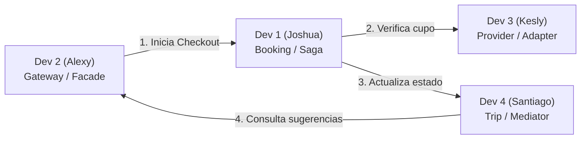

# GUIA MAESTRA DE SUSTENTACION Y DEFENSA TECNICA - WAYVO MVP

**Proyecto:** Wayvo - Plataforma Inteligente Multi-Plataforma de Viajes  
**Arquitectura:** Microservicios, Clean Architecture, 4 Patrones GoF/Arquitectonicos y Multiagentes LangGraph  
**Equipo:** Joshua Lobo (Dev 1), Alexy Salcedo (Dev 2), Kesly Rodriguez (Dev 3), Santiago Vengoechea (Dev 4)  
**Fecha:** Octubre 2026 | Universidad del Norte

---

## Tabla de Contenidos
1. [Vision General de la Dinamica de Sustentacion](#1-vision-general-de-la-dinamica-de-sustentacion)
2. [Dev 1: Joshua Lobo - Patron Saga (Booking Service & Transacciones Distribuidas)](#2-dev-1-joshua-lobo--patron-saga-orquestador)
3. [Dev 2: Alexy Salcedo - Patron Facade (API Gateway & Cliente Multiplataforma)](#3-dev-2-alexy-salcedo--patron-facade)
4. [Dev 3: Kesly Rodriguez - Patron Adapter (Provider Service & Mocks de Terceros)](#4-dev-3-kesly-rodriguez--patron-adapter)
5. [Dev 4: Santiago Vengoechea - Patron Mediator (Trip Service & LangGraph Multiagente)](#5-dev-4-santiago-vengoechea--patron-mediator)
6. [Matriz de Interaccion Cruzada y Preguntas Integrales](#6-matriz-de-interaccion-cruzada-y-preguntas-integrales)
7. [Checklist Rapido Pre-Sustentacion](#7-checklist-rapido-pre-sustentacion)

---

## 1. Vision General de la Dinamica de Sustentacion

La sustentacion individual evalua la capacidad de cada desarrollador para:
1. **Defender teoricamente** el patron asignado frente a alternativas arquitectonicas rechazadas.
2. **Navegar con fluidez el codigo fuente** mostrando la separacion de capas de Clean Architecture.
3. **Ejecutar una demostracion en vivo (Live Demo)** demostrando resiliencia, logs estructurados y correlacion distribuida.
4. **Responder preguntas complejas o "trampa"** del jurado con fundamentos de ingenieria de software (Teorema CAP, latencia de red, acoplamiento y cohesion).

---

## 2. Dev 1: Joshua Lobo - Patron Saga (Orquestador)

### 2.1 Ficha Tecnica
- **Modulos:** `services/booking-service` + Orquestador Saga + PostgreSQL `booking_db`.
- **Patron Asignado:** **Saga (Orquestacion Centralizada)** *(Patron Arquitectonico de Transacciones Distribuidas)*.
- **Tesis Central:** *"En una arquitectura de microservicios con bases de datos desacopladas (Database-per-Service), no existen transacciones ACID globales ni commits atomicos de dos fases (2PC). El patron Saga garantiza la consistencia eventual mediante una secuencia coordinada de transacciones locales y transacciones compensatorias automaticas ante cualquier falla."*

---

### 2.2 Justificacion Teorica y Alternativas Rechazadas

#### Por que Saga y no Two-Phase Commit (2PC / XA Transactions)?
- **2PC es bloqueante y no escala:** En 2PC, los recursos y filas de base de datos se bloquean durante la fase de preparacion (`prepare phase`). En microservicios que llaman a servicios de red externos (como aerolineas u hoteles con latencias de 500ms a 2s), el bloqueo provocaria saturacion del pool de conexiones, caida en cascada y violacion de la disponibilidad (Teorema CAP).
- **Incompatibilidad tecnologica:** Los proveedores externos (APIs REST de Google Flights, Hoteles) no exponen interfaces XA/2PC; solo exponen endpoints HTTP. No es posible hacer un `ROLLBACK` SQL sobre una API externa que ya emitio un ticket.

#### Por que Orquestacion y no Coreografia?
- **Coreografia (basada en eventos reactivos tipo Kafka/RabbitMQ):** Es viable para flujos sencillos, pero genera acoplamiento temporal invisible, dificultad extrema de monitoreo y riesgo de dependencias circulares de eventos.
- **Orquestacion (elegida en Wayvo):** Un coordinador explicito (`SagaOrchestrator`) centraliza la maquina de estados del flujo de confirmacion. Permite auditoria inmediata en una sola tabla (`CompensationLog`), trazabilidad con `correlationId` y logica de compensacion determinista y auditable.

---

### 2.3 Archivos Clave a Abrir en el IDE Durante la Sustentacion

1. [`services/booking-service/src/application/saga/saga-orchestrator.ts`](file:///Users/alexy/Documents/Uninorte/Octavo%20Semestre/Disen%CC%83o%202/Wayvo/services/booking-service/src/application/saga/saga-orchestrator.ts):
   - **Lineas 30-75:** Metodo principal `execute(payload: ConfirmTripSagaInput)`. Mostrar los 4 pasos hacia adelante:
     1. Crear viaje en `trip-service` en estado `PENDING`.
     2. Crear reserva local en `booking-service` en estado `PENDING`.
     3. Llamar a `provider-service` para verificar y bloquear cupos externos.
     4. Si el proveedor responde exito: marcar reserva y viaje como `CONFIRMED`.
   - **Lineas 90-140:** Metodo de compensacion `executeCompensation(...)`. Mostrar el rollback en reversa:
     1. Cancelar reserva local (`CancelBookingUseCase`).
     2. Cancelar viaje remoto en `trip-service` (`tripGateway.cancelTrip`).
     3. Persistir la traza completa en el repositorio `compensationLogRepository.save(...)`.
2. [`services/booking-service/src/domain/entities/compensation-log.entity.ts`](file:///Users/alexy/Documents/Uninorte/Octavo%20Semestre/Disen%CC%83o%202/Wayvo/services/booking-service/src/domain/entities/compensation-log.entity.ts):
   - Mostrar la entidad pura de dominio que almacena: `correlationId`, `tripId`, `bookingId`, `reason`, `failedStep` y `timestamp`.
3. [`services/booking-service/src/adapters/gateways/http/http-provider-service.gateway.ts`](file:///Users/alexy/Documents/Uninorte/Octavo%20Semestre/Disen%CC%83o%202/Wayvo/services/booking-service/src/adapters/gateways/http/http-provider-service.gateway.ts):
   - Mostrar la implementacion del puerto `IProviderGateway` usando `fetch`/HTTP desacoplado de la capa de aplicacion.

---

### 2.4 Guion de Demostracion en Vivo (Live Demo)

#### Demo A: Flujo Feliz (Confirmacion Exitosa)
1. Abrir terminal con los logs de booking: `npm run dev:booking` o `docker compose logs -f booking-service`.
2. En la aplicacion cliente o via Postman/curl, confirmar un viaje.
3. **Que mostrar en consola:**
   ```text
   [SagaOrchestrator] [CID: saga-1a2b3c] INICIANDO SAGA: Confirmacion de Viaje
   [Step 1/3] Viaje creado en trip-service -> ID: TRIP-789 (Status: PENDING)
   [Step 2/3] Reserva registrada en booking-service -> ID: BKG-456 (Status: PENDING)
   [Step 3/3] Consultando disponibilidad en provider-service -> OK: Disponible
   [SAGA EXITOSA] Confirmando entidades: Booking BKG-456 CONFIRMED, Trip TRIP-789 CONFIRMED
   ```

#### Demo B: Resiliencia y Rollback Compensatorio Automatico
1. En el DevInspector HUD de la UI (o llamando a `GET http://localhost:3002/api/v1/mock/simulate-failure?mode=unavailable`), activar el modo de falla del proveedor.
2. Intentar confirmar un viaje desde la pantalla de Checkout.
3. **Que mostrar en consola:**
   ```text
   [SagaOrchestrator] [CID: saga-err-999] [Step 3/3] Proveedor externo respondio ERROR 503 / Indisponible
   [SAGA COMPENSACION INICIADA] Reversando transacciones previas...
   [Compensacion 1/2] Cancelando reserva BKG-456 -> Nuevo Status: CANCELLED
   [Compensacion 2/2] Cancelando viaje TRIP-789 en trip-service -> Nuevo Status: CANCELLED
   [Auditoria] Registro guardado en CompensationLog con motivo: "EXTERNAL_PROVIDER_UNAVAILABLE"
   ```
4. Abrir la base de datos o consultar `GET /api/v1/saga/:correlationId/compensation-log` para mostrar el registro persistido.

---

### 2.5 Preguntas del Jurado y Respuestas Maestras

> **P1: Que pasa si el servidor de `booking-service` se apaga o crashea en el paso 2, despues de haber creado el viaje pero antes de llamar al proveedor?**  
> **Respuesta:** *"Toda Saga en produccion implementa persistencia del estado intermedio. Al iniciar el paso 1, guardamos el estado de la saga como `STARTED` con su `correlationId` y el `tripId`. Si el proceso muere, al reiniciar el microservicio, un worker lee las sagas pendientes con timeout excedido y dispara la compensacion hacia atras (`cancelTrip`), evitando que queden viajes huerfanos en estado PENDING."*

> **P2: Por que la Saga realiza una compensacion logica en lugar de un rollback tradicional de base de datos?**  
> **Respuesta:** *"Porque cada transaccion local ya hizo `COMMIT` en su base de datos respectiva para liberar locks rapidamente. Por definicion, una transaccion ya confirmada no se puede revertir con un comando `ROLLBACK` de SQL. Por eso se requiere una transaccion compensatoria, que es una nueva operacion hacia adelante de sentido opuesto (ej. `marcar como CANCELLED` o `emitir nota de credito`)."*

---

## 3. Dev 2: Alexy Salcedo - Patron Facade

### 3.1 Ficha Tecnica
- **Modulos:** `services/api-gateway` + `apps/client` (Web & Mobile Responsive).
- **Patron Asignado:** **Facade (Fachada)** *(Patron Estructural GoF)*.
- **Tesis Central:** *"El cliente web y movil no debe lidiar con la complejidad topologica, puertos heterogeneos ni protocolos internos de multiples microservicios. `TripFacade` en el API Gateway expone una interfaz simplificada y de alto nivel que compone multiples operaciones en una sola llamada, reduce drasticamente el consumo de red en dispositivos moviles y estandariza el manejo global de excepciones bajo el Requisito 8.18."*

---

### 3.2 Justificacion Teorica y Alternativas Rechazadas

#### Por que Facade y no permitir llamadas directas del cliente a cada microservicio?
- **Problema de Chatty I/O (Red Movil Ineficiente):** Si el cliente tuviera que orquestar un plan de viaje, necesitaría llamar a la IA (puerto 8000), luego a proveedores (3002) y luego a viajes (3003). En redes moviles con latencia variable, esto genera hasta 3x o 4x mas tiempo de espera percibido. Con `TripFacade`, el cliente hace un unico `POST /api/v1/trips/plan`.
- **Acoplamiento a la topologia interna:** Si dividimos `trip-service` o cambiamos su puerto o protocolo (por ejemplo a gRPC), el cliente se rompería. El Facade aisla al cliente por completo.
- **Seguridad y CORS:** No exponemos multiples puertos distintos hacia internet; solo se expone el puerto 3000 con politicas CORS estrictas.

#### Como se previene el antipatron God Object?
- La fachada **no contiene logica de negocio pesada**. No calcula tarifas ni define itinerarios; unicamente **delega, compone y transforma DTOs**. Si una solicitud no requiere agregacion, el Gateway delega limpiamente a traves de un proxy inverso.

---

### 3.3 Archivos Clave a Abrir en el IDE Durante la Sustentacion

1. [`services/api-gateway/src/application/facades/trip.facade.ts`](file:///Users/alexy/Documents/Uninorte/Octavo%20Semestre/Disen%CC%83o%202/Wayvo/services/api-gateway/src/application/facades/trip.facade.ts):
   - **Metodo `planTrip(input)`:** Mostrar como recibe las respuestas del motor de IA (`ai-recommendation:8000`) y estructura la propuesta consumible por el cliente.
   - **Metodo `checkoutTrip(input)`:** Mostrar como invoca a `booking-service` (Saga) propagando el correlation ID.
2. [`services/api-gateway/src/adapters/http/middlewares/error.middleware.ts`](file:///Users/alexy/Documents/Uninorte/Octavo%20Semestre/Disen%CC%83o%202/Wayvo/services/api-gateway/src/adapters/http/middlewares/error.middleware.ts) *(Requisito 8.18)*:
   - Mostrar como captura cualquier excepcion interna y responde con el formato estandar `{ success: false, error: { code, message, details } }`.
3. [`apps/client/src/App.tsx`](file:///Users/alexy/Documents/Uninorte/Octavo%20Semestre/Disen%CC%83o%202/Wayvo/apps/client/src/App.tsx) y [`apps/client/src/components/MyTripsView.tsx`](file:///Users/alexy/Documents/Uninorte/Octavo%20Semestre/Disen%CC%83o%202/Wayvo/apps/client/src/components/MyTripsView.tsx):
   - Mostrar la arquitectura del cliente: renderizado con Tailwind, modales montados con React Portal (`createPortal`) para evitar bloqueos de viewport, y consumo centralizado a traves de `WayvoApi` apuntando unicamente al puerto 3000.

---

### 3.4 Guion de Demostracion en Vivo (Live Demo)

#### Demo A: Agregacion de Facade en Planificacion de Viaje
1. En el navegador (puerto 5173), completar el onboarding y presionar "Generar Propuesta con IA".
2. Abrir la pestana **Network** de las DevTools del navegador.
3. **Que destacar:** El frontend solo hace **1 peticion HTTP**: `POST http://localhost:3000/api/v1/trips/plan`.
4. Mostrar en la consola del Gateway como `TripFacade` interactua internamente con el servicio multiagente de Python y normaliza la respuesta.

#### Demo B: Middleware Centralizado de Errores (Requisito 8.18)
1. Enviar una peticion con payload invalido o ID inexistente (ej. `GET http://localhost:3000/api/v1/trips/id-invalido-xyz`).
2. Mostrar la respuesta homogenea en JSON:
   ```json
   {
     "success": false,
     "error": {
       "code": "TRIP_NOT_FOUND",
       "message": "El viaje especificado no existe o ha sido eliminado",
       "details": { "tripId": "id-invalido-xyz" }
     }
   }
   ```

---

### 3.5 Preguntas del Jurado y Respuestas Maestras

> **P1: Cual es la diferencia entre un API Gateway generico y el patron de diseno Facade?**  
> **Respuesta:** *"Un API Gateway generico actua fundamentalmente como un Reverse Proxy que enruta URL por URL (`/trips` hacia el puerto 3003, `/providers` hacia el 3002). El patron Facade va mas alla: agrega y compone multiples servicios en una sola abstraccion simplificada. Por ejemplo, `/api/v1/trips/checkout` orquesta la transaccion sin que el cliente sepa que existen 3 microservicios coordinados por detras."*

> **P2: Si el Gateway se cae, se cae toda la plataforma? Como resuelven este Single Point of Failure (SPOF)?**  
> **Respuesta:** *"El Gateway esta disenado como un servicio completamente **Stateless** (sin estado en memoria). En produccion se despliegan multiples replicas detras de un balanceador de carga de capa 4 o capa 7 (como Nginx, AWS ALB o Kubernetes Ingress), lo que permite escalar horizontalmente y eliminar cualquier punto unico de falla."*

---

## 4. Dev 3: Kesly Rodriguez - Patron Adapter

### 4.1 Ficha Tecnica
- **Modulos:** `services/provider-service` + Mocks de APIs Externas + PostgreSQL `provider_db`.
- **Patron Asignado:** **Adapter (Adaptador)** *(Patron Estructural GoF)*.
- **Tesis Central:** *"Las APIs externas de proveedores turisticos (aerolineas como Google Flights/SerpAPI, hoteles y actividades) son heterogeneas, cambiantes e incontrolables. El patron Adapter crea una capa de aislamiento mediante la interfaz target `IProveedorExterno`, desacoplando completamente las reglas de negocio de Wayvo de los contratos especificos de terceros."*

---

### 4.2 Justificacion Teorica y Alternativas Rechazadas

#### Por que Adapter y no invocar directamente las librerias o APIs externas en los Casos de Uso?
- **Violacion de Clean Architecture e Inversion de Dependencias (DIP):** Si un caso de uso como `CheckAvailabilityUseCase` conoce los parametros especificos de la API de SerpAPI (`engine: 'google_flights'`, `departure_id: 'BAQ'`), el nucleo de negocio queda atado a un proveedor externo. Si SerpAPI sube precios o cambia a JSON Schema v2, habria que reescribir la logica de la empresa.
- **Principio Abierto/Cerrado (OCP):** Con el patron Adapter, para soportar un nuevo proveedor (ej. Amadeus o Airbnb), unicamente se crea una nueva clase `AmadeusAdapter` que implemente `IProveedorExterno` y se registra en `ProveedorExternoRegistry`. **No se modifica ni una sola linea de los casos de uso existentes.**

---

### 4.3 Archivos Clave a Abrir en el IDE Durante la Sustentacion

1. [`services/provider-service/src/application/ports/proveedor-externo.port.ts`](file:///Users/alexy/Documents/Uninorte/Octavo%20Semestre/Disen%CC%83o%202/Wayvo/services/provider-service/src/application/ports/proveedor-externo.port.ts):
   - Mostrar la interfaz target estandarizada:
     - `consultarDisponibilidad(criterios: DisponibilidadQuery): Promise<DisponibilidadResultado>`
     - `confirmarReserva(datos: ReservaDatos): Promise<ConfirmacionResultado>`
2. [`services/provider-service/src/adapters/external/transporte.adapter.ts`](file:///Users/alexy/Documents/Uninorte/Octavo%20Semestre/Disen%CC%83o%202/Wayvo/services/provider-service/src/adapters/external/transporte.adapter.ts):
   - Mostrar como traduce los criterios de Wayvo (`origen`, `destino`, `fecha`) al formato requerido por la API de vuelos y como transforma la respuesta externa al modelo canonico de Wayvo (`disponible: boolean`, `precioEstimado`, `referenciaExterna`).
3. [`services/provider-service/src/adapters/external/alojamiento.adapter.ts`](file:///Users/alexy/Documents/Uninorte/Octavo%20Semestre/Disen%CC%83o%202/Wayvo/services/provider-service/src/adapters/external/alojamiento.adapter.ts):
   - Mostrar la adaptacion para hoteles y hospedaje.
4. [`services/provider-service/src/infrastructure/mock/mock-inventory.ts`](file:///Users/alexy/Documents/Uninorte/Octavo%20Semestre/Disen%CC%83o%202/Wayvo/services/provider-service/src/infrastructure/mock/mock-inventory.ts) y controlador de caos:
   - Mostrar el mecanismo de inyeccion de fallos controlados para pruebas de resiliencia (`mode=unavailable`).

---

### 4.4 Guion de Demostracion en Vivo (Live Demo)

#### Demo A: Consulta Estandarizada a Proveedores Heterogeneos
1. Ejecutar una consulta de disponibilidad de vuelos y hoteles:
   `POST http://localhost:3002/api/v1/providers/check-availability`
2. Mostrar como la respuesta que sale del microservicio tiene exactamente la misma estructura uniforme (`{ available: true, referenceId: "...", details: {...} }`), independientemente de si el servicio consultado fue un vuelo o un hotel.

#### Demo B: Simulador de Caos y Fallo de Terceros
1. Invocar el endpoint de conmutacion de fallos:
   `GET http://localhost:3002/api/v1/mock/simulate-failure?mode=unavailable`
2. Mostrar en consola el cambio de estado del simulador:
   `[ProviderChaos] MODO FALLO ACTIVADO: Simulando indisponibilidad en APIs de aerolineas.`
3. Repetir la consulta de disponibilidad y mostrar el error controlado `503 PROVIDER_UNAVAILABLE`.
4. Explicar como este fallo es la clave que activa el rollback de la Saga de Joshua (Dev 1).
5. Restaurar el modo normal:
   `GET http://localhost:3002/api/v1/mock/simulate-failure?mode=normal`

---

### 4.5 Preguntas del Jurado y Respuestas Maestras

> **P1: Cual es la diferencia entre el patron Adapter y el patron Facade que uso Alexy?**  
> **Respuesta:** *"Aunque ambos son estructurales segun GoF, resuelven problemas distintos. El **Facade** simplifica una interfaz compleja o agrupa multiples subsistemas para conveniencia del cliente. El **Adapter**, en cambio, convierte una interfaz existente e incompatible (el adaptee externo) para que coincida con una interfaz esperada por el cliente (el target `IProveedorExterno`). En resumen: Facade define una interfaz nueva y mas simple; Adapter hace que dos interfaces incompatibles puedan comunicarse."*

> **P2: Como manejan el problema de los tiempos de espera (timeouts) si una API de aerolinea tarda 15 segundos en responder?**  
> **Respuesta:** *"En los adaptadores implementamos una politica de timeout explicita (con `AbortController` fijado a 3000ms) y reintentos con backoff exponencial. Si la API de terceros no responde en ese plazo, el adaptador lanza un error tipado de tipo `ProviderTimeoutError`, impidiendo que el hilo quede bloqueado indefinidamente."*

---

## 5. Dev 4: Santiago Vengoechea - Patron Mediator

### 5.1 Ficha Tecnica
- **Modulos:** `services/trip-service` + `services/ai-recommendation` (Python LangGraph) + PostgreSQL `trip_db`.
- **Patron Asignado:** **Mediator (Mediador)** *(Patron de Comportamiento GoF)*.
- **Tesis Central:** *"En la gestion dinamica de un viaje, cuando ocurre un imprevisto, multiples servicios deben reaccionar: registrar la novedad, solicitar alternativas inteligentes y actualizar el itinerario. Si estos servicios se llamaran entre si, tendriamos un acoplamiento 'muchos a muchos' en forma de telarana. `TripMediator` centraliza y orquesta todas las comunicaciones entre colegas (`EventService`, `AlternativeService`, `TripService`), eliminando cualquier dependencia directa entre ellos."*

---

### 5.2 Justificacion Teorica y Alternativas Rechazadas

#### Por que Mediator y no llamadas directas entre servicios?
- **Evitar la telarana de dependencias (Spaghetti Architecture):** Sin un mediador, `EventService` tendria que inyectar a `AlternativeService` y a `TripService`. A su vez, `TripService` necesitaría conocer los eventos para refrescar el estado. Esto crea dependencias circulares y hace casi imposible realizar pruebas unitarias aisladas.
- **Regla estricta del Mediador en Wayvo:** `EventService` y `TripService` **tienen CERO referencias mutuas**. No se conocen. Cuando `EventService` detecta que un evento fue marcado como incidencia, simplemente notifica al mediador: `this.mediator.notify(this, 'INCIDENT_OCCURRED', data)`.

#### Por que LangGraph para el motor multiagente en Python?
- **Arquitectura de Grafo de Estados (`StateGraph`):** A diferencia de un pipeline lineal rigido, LangGraph permite que agentes especializados con roles definidos compartan un estado comun (`TripPlanState`). Los nodos son:
  1. `personality_agent`: Sintetiza el arquetipo turistico (Aventura, Relax, Cultural, Inversion).
  2. `budget_agent`: Distribucion financiera porcentual (transporte, hospedaje, alimentacion, imprevistos).
  3. `transport_agent`: Rutas y conectividad de entrada y salida.
  4. `activities_food_agent`: Cronograma de planes y gastronomia local autentica.
  5. `incident_agent`: Generador de soluciones inteligentes ante cancelaciones en ruta.

---

### 5.3 Archivos Clave a Abrir en el IDE Durante la Sustentacion

1. [`services/trip-service/src/application/mediator/IMediator.ts`](file:///Users/alexy/Documents/Uninorte/Octavo%20Semestre/Disen%CC%83o%202/Wayvo/services/trip-service/src/application/mediator/IMediator.ts):
   - Mostrar la interfaz del patron GoF:
     ```typescript
     export interface IMediator {
       notify(sender: object, event: string, data?: any): Promise<any>;
     }
     ```
2. [`services/trip-service/src/application/mediator/TripMediator.ts`](file:///Users/alexy/Documents/Uninorte/Octavo%20Semestre/Disen%CC%83o%202/Wayvo/services/trip-service/src/application/mediator/TripMediator.ts):
   - **Lineas 25-65:** Mostrar como recibe las notificaciones `'INCIDENT_REPORTED'` y `'RESOLVE_INCIDENT'`.
   - Mostrar como instruye a `EventService` para marcar el evento original como `CANCELLED` y a `TripService` para inyectar el nuevo evento sustituto, sin que ninguno de ellos se llame directamente.
3. [`services/ai-recommendation/application/graph.py`](file:///Users/alexy/Documents/Uninorte/Octavo%20Semestre/Disen%CC%83o%202/Wayvo/services/ai-recommendation/application/graph.py) y [`incident_agent.py`](file:///Users/alexy/Documents/Uninorte/Octavo%20Semestre/Disen%CC%83o%202/Wayvo/services/ai-recommendation/application/incident_agent.py):
   - Mostrar la construccion del `StateGraph` de LangGraph y como el agente de incidentes razona contextualmente ante la perdida de un transporte o actividad.

---

### 5.4 Guion de Demostracion en Vivo (Live Demo)

#### Demo A: Desacoplamiento de Incidencias en Vivo
1. En la aplicacion cliente (vista de Itinerario Activo), ubicar un evento futuro (ej. "Tarde en Parque Tayrona").
2. Presionar el boton **"Reportar Eventualidad"** y seleccionar el motivo: *"Lluvia torrencial / Cierre de parque"*.
3. **Que mostrar en consola de `trip-service`:**
   ```text
   [TripMediator] Notificacion recibida de EventController: "INCIDENT_REPORTED"
   [TripMediator] -> Delegando a EventService: Registrar incidencia para evento EVT-102
   [TripMediator] -> Delegando a AlternativeService: Consultar IA para 3 alternativas de solucion
   [AlternativeService] Llamando a ai-recommendation (:8000)...
   [TripMediator] Retornando 3 opciones viables al usuario.
   ```
4. En el modal del frontend, mostrar las 3 opciones sugeridas por el agente (ej. "Visita a Museo del Oro Tairona", "Tarde de Spa y Cafe local", "Almuerzo tipico en centro historico").

#### Demo B: Confirmacion y Sustitucion de Evento
1. En el modal, seleccionar una de las alternativas y presionar **"Confirmar Sustitucion"**.
2. **Que destacar visualmente en la UI:**
   - El evento original cambia a estado tachado y rojo con el badge **`CANCELADO`** y la nota *"Sustituido por..."*.
   - Debajo se inserta inmediatamente el nuevo evento con el badge **`SUSTITUTO IA`**.
3. Explicar al profesor que esta sincronizacion ocurrio gracias a que `TripMediator` orquesto a `EventService` y `TripService`.

---

### 5.5 Preguntas del Jurado y Respuestas Maestras

> **P1: Cual es la diferencia entre el patron Mediator y el patron Observer?**  
> **Respuesta:** *"En el patron **Observer**, los objetos subscriptores dependen directamente del sujeto u observable (comunicacion 1 a N unidireccional). En el patron **Mediator**, la comunicacion es bidireccional y multilateral (M a N): los colegas no saben quienes son los otros participantes ni se suscriben entre si; solo conocen al mediador central, quien encapsula la logica de interaccion completa."*

> **P2: Por que construyeron el motor de IA en Python con FastAPI y LangGraph en lugar de llamar a OpenAI directamente desde TypeScript en Node.js?**  
> **Respuesta:** *"Por especializacion de dominio y capacidades del ecosistema. Python es el estandar en IA. LangGraph nos ofrece gestion determinista de ciclos, memoria de estados (`StateGraph`), evaluacion de checkpoints y orquestacion multiagente nativa. Al exponerlo como un microservicio independiente con FastAPI, desacoplamos el ciclo de vida del LLM del backend transaccional de Node.js."*

---

## 6. Matriz de Interaccion Cruzada y Preguntas Integrales

Esta seccion prepara al equipo para preguntas donde el profesor intente evaluar si cada estudiante comprende como su modulo se comunica con el de sus companeros.



### Tabla de Interacciones Cruzadas

| Pregunta Cruzada del Profesor | Quien Responde | Argumento Tecnico |
| :--- | :--- | :--- |
| *"Si el servicio de Kesly (Provider) falla, que le devuelve el servicio de Joshua (Saga) al Gateway de Alexy?"* | **Joshua + Alexy** | Joshua explica que la Saga detecta el error en el paso 3, activa la compensacion y retorna un codigo HTTP 422 con status `COMPENSATED`. Alexy complementa que su `TripFacade` recibe esa respuesta, el middleware 8.18 la normaliza y la UI le informa al usuario que el viaje fue cancelado sin cobros. |
| *"Como sabe el Mediador de Santiago (Dev 4) que eventos estan reservados por el servicio de Joshua (Dev 1)?"* | **Santiago + Joshua** | Santiago explica que los eventos tienen un estado `CONFIRMED` que fue establecido cuando la Saga de Joshua culmino con exito. El Mediador solo opera sobre itinerarios ya confirmados por la transaccion distribuida. |
| *"Como viaja la trazabilidad si ocurre un error entre los 4 servicios?"* | **Todo el equipo** | Alexy genera el `x-correlation-id` en el Gateway; Joshua lo propaga en los encabezados HTTP hacia Provider y Trip Service; Kesly y Santiago lo imprimen en sus logs de consola y Joshua lo almacena en `CompensationLog`. |

---

## 7. Checklist Rapido Pre-Sustentacion

Antes de iniciar la llamada o sesion de evaluacion:

- [ ] **Docker / Servidores arriba:**
  - `docker compose up -d` (o terminales individuales de npm levantadas).
  - Verificar que los 6 puertos respondan: 5173 (Cliente), 3000 (Gateway), 3001 (Booking), 3002 (Provider), 3003 (Trip), 8000 (AI).
- [ ] **Bases de datos migradas y con datos precargados:**
  - `booking_db`, `provider_db`, `trip_db` activas en Docker.
- [ ] **Pestanas del navegador listas:**
  - `http://localhost:5173` (Wayvo UI con el DevInspector HUD visible).
  - Pestana de Red de las DevTools lista para mostrar encabezados `x-correlation-id`.
- [ ] **Archivos abiertos en el editor de codigo:**
  - Joshua: `saga-orchestrator.ts` y `compensation-log.entity.ts`.
  - Alexy: `trip.facade.ts` y `error.middleware.ts`.
  - Kesly: `proveedor-externo.port.ts` y `transporte.adapter.ts`.
  - Santiago: `TripMediator.ts` y `graph.py` / `incident_agent.py`.
